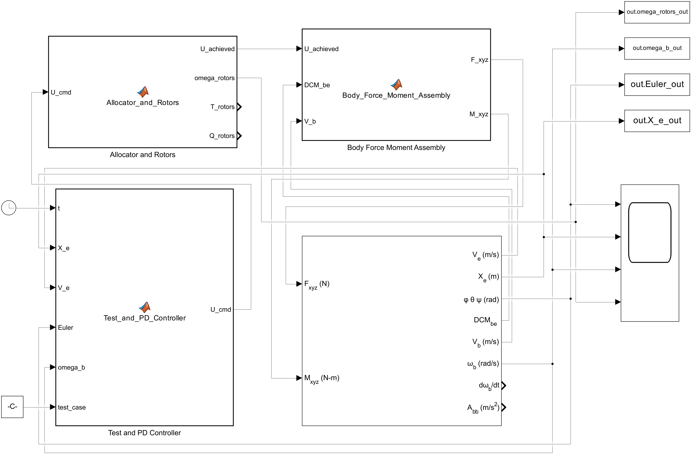
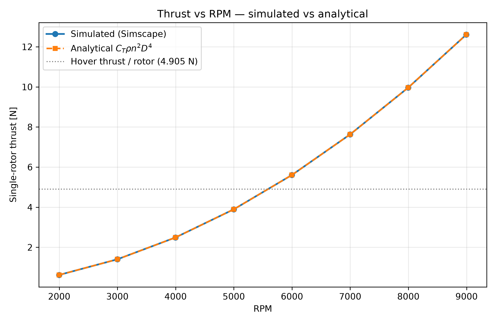
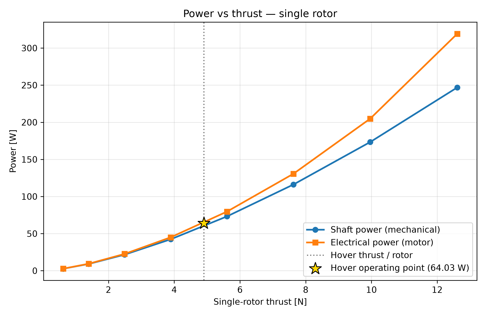
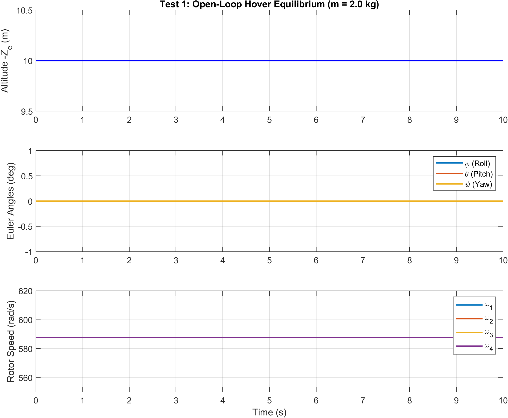
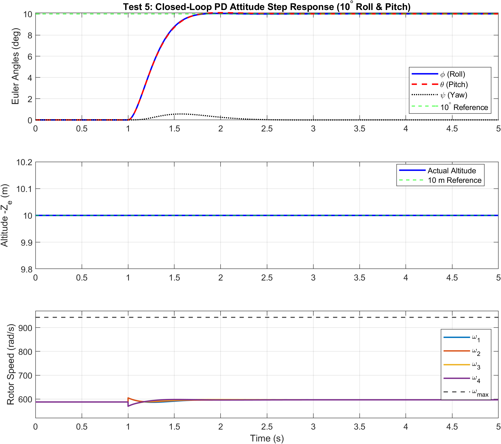
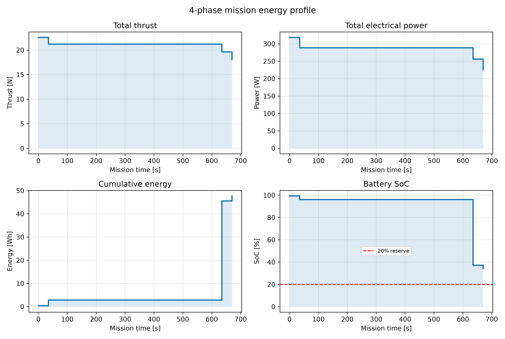
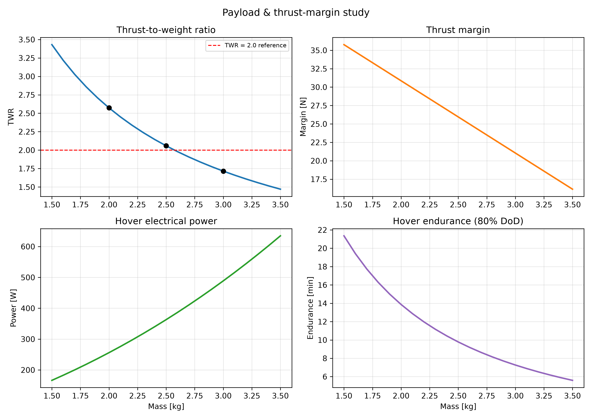
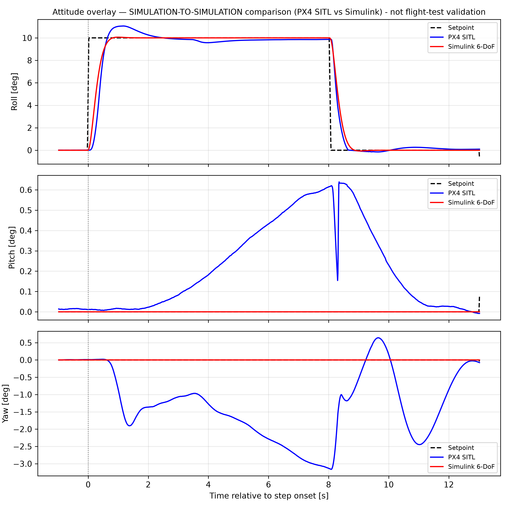
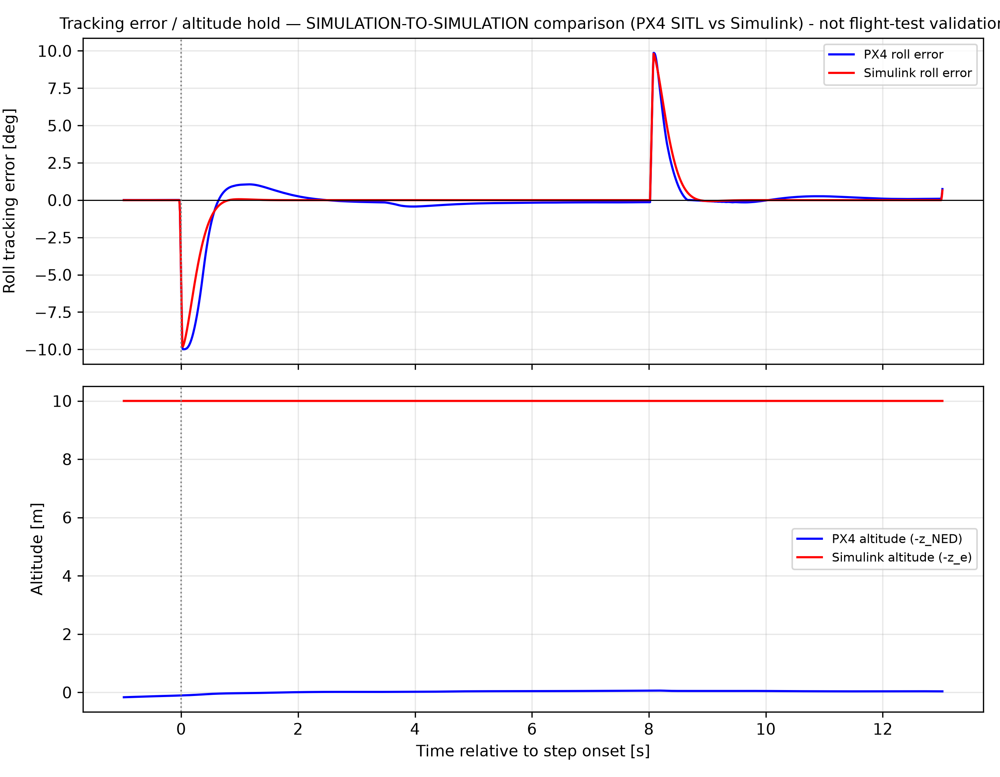

# Quadrotor System Modelling

**A traceable, simulation-only engineering study of a 2 kg quadrotor** — from legacy model audit and propulsion characterisation through a 6-DoF plant, mission-energy analysis, and a PX4 Gazebo SITL cross-simulation.

> **Scope of evidence.** Every result in this repository is either an **analytical consistency check** or a **numerical simulation result**. There is **no physical flight testing, no hardware-in-the-loop testing, and no claim of controller equivalence**. The PX4 comparison is simulation-to-simulation. See [Evidence classes](#evidence-classes) and [Known limitations](#known-limitations).

---

## Evidence classes

Terminology used throughout this document:

| Class | Meaning | Primary evidence in this repository |
|---|---|---|
| **Analytical consistency check** | Two independent formulations of the same model agree; no experiment involved. | `propulsion_analysis/verification_calculations.py`, `propulsion_analysis/propulsion_verification_summary.csv` |
| **Numerical simulation** | Output of a Simscape, Simulink or PX4/Gazebo model under stated assumptions. | `models/`, `flight_dynamics_6dof/`, `mission_analysis/`, `px4_comparison/` |
| **Physical validation** | Measurement on real hardware. | **None present.** Not claimed anywhere in this repository. |

Component values are classified separately as *design specification*, *representative component specification*, or *analytically derived*; see `configuration/component_sources.md`. No manufacturer part numbers or datasheet curves are asserted.

---

## 1. System configuration and assumptions

Baseline vehicle (`configuration/vehicle_configuration.md`):

| Parameter | Symbol | Value | Unit | Basis |
|---|---|---|---|---|
| Total mass | `m` | 2.00 | kg | Design specification |
| Arm length (centre → rotor) | `l` | 0.225 | m | Design specification (450 mm wheelbase) |
| Gravity | `g` | 9.81 | m/s² | Design specification |
| Principal inertia (diagonal) | `J` | diag(0.021, 0.021, 0.040) | kg·m² | Symmetric rigid-body approximation — **not measured** |
| Linear drag matrix | `D_drag` | diag(0, 0, 0) | N/(m/s) | Deliberate omission for baseline traceability |
| Motor | — | 2216-class, 920 KV BLDC | — | Representative component specification |
| Winding resistance | `R_m` | 0.085 | Ω | Representative component specification |
| Propeller diameter | `D` | 0.254 | m (10 in) | Design specification |
| Thrust / torque coefficient | `C_T` / `C_Q` | 0.110 / 0.0090 | — | Representative component specification |
| Battery | — | 4S LiPo, 14.8 V, 5.0 Ah, `R_0` = 0.020 Ω | — | Design specification |
| Usable depth of discharge | `DoD` | 0.80 | — | Mission-study assumption, not a manufacturer limit |

Derived bridge constants (computed from first principles, **not fitted** to the sweep):

```
ρ  = 1.225 kg/m³
kf = C_T·ρ·D⁴ / (4π²) = 1.420705e-5 N/(rad/s)²
km = C_Q·ρ·D⁵ / (4π²) = 2.952483e-7 N·m/(rad/s)²
ω_hover = √(m·g / 4kf) = 587.58 rad/s = 5611 RPM
```

`kf` and `km` re-derived independently by `propulsion_analysis/verification_calculations.py` agree with `models/new_build/init_6dof_params.m` to approximately 1e-13 relative.

The legacy models preserved in `models/original/` contained documented defects (helicopter-scale rotor, zero winding resistance, 3.6 V single cell, zero yaw authority, 0.07 kg airframe). They were **audited, not repaired**; the corrected model and new plant replace them. See `configuration/parameter_register_and_audit.csv` and `configuration/Quadrotor_Step4_Architecture_Decision_Note.md`.

---

## 2. Simulation architecture



*Architecture diagram reproduced from `configuration/Quadrotor_6DoF_architecture.png`.*

| Stage | Artefact | Role |
|---|---|---|
| Frozen configuration | `configuration/vehicle_configuration.md`, `configuration/parameter_register_and_audit.csv` | Single source of parameters and their classification |
| Legacy audit | `models/original/ElectroMechanics_Q.slx`, `models/original/HoverLock.slx` | Unmodified evidence; defects documented, models retired |
| Corrected propulsion | `models/modified/ElectroMechanics_Q_modified.slx` (+ `_improved` variant) | Simscape electrical/mechanical model, swept over 8 operating points |
| Propulsion verification | `propulsion_analysis/verification_calculations.py` | Independent analytical check of thrust, torque, power and bridge constants |
| New plant | `models/new_build/Quadrotor_6DoF.slx`, `models/new_build/init_6dof_params.m` | 12-state rigid-body plant, mixer, saturation and baseline PD |
| Plant tests | `models/new_build/run_step5_tests.m` | Five tests; outputs in `flight_dynamics_6dof/test*/` |
| Mission study | `mission_analysis/run_mission_analysis.py` | Power fit, payload margin, sensitivity, 4-phase energy profile |
| Cross-simulation | `px4_comparison/scripts/`, `models/new_build/run_step7_px4_replay.m` | PX4/Gazebo telemetry → replay in plant → quantitative comparison |
| Paper | `report/final_report.md` → `.pdf` / `.docx` | Full derivation, tables, figures and limitations |

The propulsion model feeds the 6-DoF plant through `kf`/`km`. The mission study uses the fitted electrical power curve from the propulsion sweep. The PX4 comparison replays setpoints recorded in Gazebo into the same plant — it does **not** couple two controllers into one loop.

---

## 3. Propulsion subsystem

Implemented in `propulsion_analysis/verification_calculations.py` and the Simscape model:

```
n        = RPM / 60                    [rev/s]
ω        = 2π·n                        [rad/s]
T_an     = C_T·ρ·n²·D⁴                 [N, per rotor]
Q_an     = C_Q·ρ·n²·D⁵                 [N·m, per rotor]
P_shaft  = Q_an·ω                      [W]
P_elec   = V_terminal·I_motor          [W]
η_total  = P_shaft / P_elec
```

Sweep (`propulsion_analysis/operating_point_sweep.csv`, 8 points):

| Quantity | Min | Max | Unit |
|---|---:|---:|---|
| Rotor speed | 1999.3 | 8996.1 | RPM |
| Thrust per rotor | 0.623 | 12.609 | N |
| Pack current | 0.747 | 99.694 | A |
| Terminal voltage | 12.806 | 14.785 | V |
| Total efficiency | 77.34 | 98.11 | % |

Analytical consistency check (`propulsion_analysis/propulsion_verification_summary.csv`):

| Metric | Max absolute error |
|---|---:|
| Thrust | 0.0073 % |
| Torque | 0.0031 % |
| Shaft power | 0.0032 % |

`P_elec > P_shaft` at all 8 points. These are **agreement between two models**, not measured motor data.




*Left: simulated and analytical thrust. Right: shaft/electrical power with the hover point marked.*

Model limitations: static quadratic rotor model (`T = kf·ω²`, `Q = km·ω²`), instantaneous rotor speed (no motor/ESC lag), no dynamic inflow, zero aerodynamic drag in the 6-DoF loop.

---

## 4. Six-degree-of-freedom vehicle dynamics

**State:** `[x, y, z, u, v, w, φ, θ, ψ, p, q, r]`.
**Frames:** body FRD (forward–right–down), earth NED (north–east–down), flat-earth assumption; ZYX Euler sequence. Integration uses the Aerospace Blockset 6DOF (Euler Angles) block in MKS units — there is no handwritten integrator. `configuration/vehicle_configuration.md` documents the gravity transform, allocation matrices and saturation.

Control allocation (`B_eff`, Quad-+ rotor layout) and its inverse `B_mixer` map desired total thrust and body moments to four squared rotor speeds, with saturation applied to `ω²` before the square root:

```
ω_i = sqrt(max(0, min(ω_max², ω_i,cmd²)))
```

Baseline single-loop PD gains (simulation-tuned, not hardware-tuned):

| Loop | `Kp` | `Kd` | Design target |
|---|---:|---:|---|
| Altitude `z` | 18.0 | 10.8 | ωn = 3 rad/s, ζ = 0.9 |
| Roll `φ` / pitch `θ` | 0.756 | 0.2142 | ωn = 6 rad/s, ζ = 0.85 |
| Yaw `ψ` | 0.640 | 0.2880 | ωn = 4 rad/s, ζ = 0.9 |

Step 5 tests (`models/new_build/run_step5_tests.m`):

| Test | Condition | Duration | Evidence |
|---|---|---|---|
| 1 | Open-loop hover equilibrium, 2.0 kg | 10 s | `flight_dynamics_6dof/test1_hover_equilibrium/` |
| 2 | Pure roll and pitch pulses, 0.01 N·m | 2 s each | `flight_dynamics_6dof/test2_roll_pitch_response/` |
| 3 | Pure yaw pulse, 0.02 N·m | 5 s | `flight_dynamics_6dof/test3_yaw_response/` |
| 4 | Payload equilibrium at 2.0 / 2.5 / 3.0 kg | 5 s each | `flight_dynamics_6dof/test4_payload_equilibrium/` |
| 5 | Closed-loop PD, +10° roll and pitch step at t = 1 s | 5 s | `flight_dynamics_6dof/test5_pd_control_response/` |

Payload equilibrium (`flight_dynamics_6dof/test4_payload_equilibrium/test4_payload_summary.csv`):

| Mass (kg) | Hover thrust (N) | Hover speed (rad/s) | Hover RPM | TWR | Thrust margin (N) |
|---:|---:|---:|---:|---:|---:|
| 2.0 | 19.62 | 587.58 | 5611 | 2.573 | 30.86 |
| 2.5 | 24.53 | 656.94 | 6273 | 2.058 | 25.95 |
| 3.0 | 29.43 | 719.64 | 6872 | 1.715 | 21.05 |

Test 5 roll response (numerical simulation): RMSE 1.539°, overshoot 0.627 %, rise time 0.43 s, 2 % settling 0.69 s. The payload in Test 4 is assumed centrally mounted at the CoM; the baseline inertia tensor is retained, not re-identified.




*Left: Test 1 hover equilibrium. Right: Test 5 closed-loop PD step response.*

---

## 5. Mission energy and endurance

Four-phase profile from `mission_analysis/run_mission_analysis.py`; source data `mission_analysis/mission_energy.csv`:

| Phase | Duration (s) | Thrust (N) | Electrical power (W) | Current (A) | Phase energy (Wh) | End SoC (%) |
|---|---:|---:|---:|---:|---:|---:|
| Take-off | 5 | 22.563 | 318.12 | 22.02 | 0.442 | 99.39 |
| Climb | 30 | 21.190 | 288.39 | 19.92 | 2.403 | 96.07 |
| Hover | 600 | 19.620 | 256.10 | 17.67 | 42.684 | 37.18 |
| Descent | 35 | 18.050 | 225.58 | 15.55 | 2.193 | 34.15 |
| **Total** | **670** | — | — | — | **47.722** | **34.15** |

The electrical power model is a cubic fit to the propulsion sweep (`R²` = 0.999935, RMSE = 0.838 W). Hover power at 2.0 kg is 256.1 W. Endurance at 80 % DoD is 13.87 min at 2.0 kg, 9.78 min at 2.5 kg, and 7.27 min at 3.0 kg (`mission_analysis/payload_thrust_margin.csv`).

A ±10 % one-at-a-time sensitivity study (`mission_analysis/parameter_sensitivity.csv`) shows propeller diameter dominating: −10 % `D` raises hover RPM by 23.46 % and cuts maximum thrust and TWR by 34.39 %; `C_T` ±10 % moves TWR by ∓10 %. Battery capacity sensitivity (`mission_analysis/battery_sensitivity.csv`) treats both fixed-mass and mass-adjusted packs (0.10 kg per Ah relative to 5 Ah); a 4 Ah fixed-mass pack misses the 20 % reserve assumption.




*Left: four-phase power/energy/SoC profile. Right: thrust margin and endurance versus mass.*

Endurance figures are estimates from a fitted power model and coulomb counting; no physical discharge test was performed.

---

## 6. PX4 SITL cross-simulation

Scenario (`px4_comparison/comparison_results/attitude_step_run.json`): standard `gz_x500` in Gazebo, MAVSDK offboard at 5 Hz, +10° roll step held 8 s at 2.5 m altitude target. PX4 ULog telemetry is extracted, time-aligned (1 s pre-step, 5 s post-step, 100 Hz) and replayed as setpoints into `models/new_build/Quadrotor_6DoF.slx` (`test_case = 7`). Both systems use FRD body / NED earth; **no NED-to-NWU sign flip is applied** — see `configuration/Quadrotor_Step4_Architecture_Decision_Note.md`, `px4_comparison/scripts/extract_ulog.py` and `px4_comparison/scripts/compare_px4_vs_6dof.py`.

Tracking metrics, degrees (`px4_comparison/comparison_results/px4_vs_6dof_metrics.csv`):

| Axis | PX4 RMSE vs setpoint | Plant RMSE vs setpoint | Cross-simulation RMSE | PX4 steady error | Plant steady error |
|---|---:|---:|---:|---:|---:|
| Roll (excited) | 1.968 | 1.539 | **0.629** | 0.074 | 0.217 |
| Pitch (cross-axis) | 0.322 | ≈0 | 0.322 | 0.594 | ≈0 |
| Yaw (cross-axis) | 1.849 | ≈0 | 1.849 | −3.045 | ≈0 |

Transient roll response:

| Quantity | PX4 SITL | 6-DoF plant |
|---|---:|---:|
| Overshoot (%) | 10.57 | 0.627 |
| Rise time (s) | 0.33 | 0.43 |
| 2 % settling time (s) | 5.33 | 0.69 |
| Peak body rate (rad/s) | 0.536 | 0.426 |

**What this comparison is not:** not physical flight validation, not HIL, not controller equivalence (PX4 uses cascaded PID with rate limiting and feedforward; the plant uses single-loop PD), and not a valid altitude-hold comparison — the PX4 step occurs at roughly 0.04 m above ground, where ground effect and saturation dominate.




*Left: setpoint, PX4 SITL and plant attitude overlay. Right: roll tracking error and altitude trace.*

---

## 7. Engineering interpretation

- The propulsion agreement (< 0.01 %) confirms that the analytical bridge constants and the Simscape model implement the same momentum-theory relationship; it does not validate either against a real motor.
- The plant is self-consistent: hover equilibrium, payload scaling and the mission hover point use the same `kf` and agree to within 0.5 %.
- The plant responds faster and with far less overshoot than PX4 (0.63 s vs 5.33 s settling) because it omits actuator lag, drag, estimator noise and uses a simpler controller. The 0.629° cross-simulation RMSE is a **difference between two simulators**, not an accuracy figure.
- Diameter sensitivity (`D⁴` in thrust) dominates `C_T` sensitivity, so propeller selection is the highest-leverage design choice in this model.
- A 4 Ah pack of the assumed type does not meet the assumed 20 % reserve; 5 Ah does, under the stated power fit and DoD assumption.

---

## 8. Known limitations

1. No physical flight testing, bench testing, HIL or flight data.
2. Inertia tensor is a symmetric approximation, not measured or CAD-derived.
3. Aerodynamic drag is intentionally zero; no forward-flight aerodynamics or ground effect model.
4. Static quadratic rotor model; instantaneous rotor speed; no motor/ESC lag or dynamic inflow.
5. Ideal sensors and actuation in the plant.
6. Battery DoD limit and endurance are assumptions/estimates, not validated discharge data.
7. Maximum thrust is static, at sea-level density and ω_max.
8. TWR of 2.573 applies only at the 2.0 kg baseline.
9. PX4 comparison is simulation-to-simulation, with non-equivalent altitude behaviour and non-equivalent controllers.
10. Controller gains are simulation-tuned; no LQR/MPC, autonomy, perception, certification or real-time guarantee is claimed.

---

## 9. Reproducing the analysis

### Software requirements

| Component | Requirement | Used for |
|---|---|---|
| Python | 3.8+ | All analysis scripts |
| Python packages | `numpy`, `pandas`, `matplotlib`, `pyulog`, `mavsdk`, `pypandoc-binary` | See `requirements.txt`; `mavsdk` only for PX4 interaction |
| MATLAB | R2026b (as documented in `configuration/component_sources.md`) | `.m` scripts and `.slx` models |
| Simulink + Aerospace Blockset | 6DOF (Euler Angles) block, MKS | 6-DoF plant |
| Simscape / Simscape Electrical | Required to open the propulsion `.slx` models | Propulsion model |
| `pandoc` + `tectonic` | PDF/DOCX rebuild only | `report/build_report.py` |
| Docker + `docker compose` | PX4 SITL only | `compose.yaml` |

Python-only checks (no MATLAB or Docker needed):

```bash
python3 -m pip install -r requirements.txt
python3 propulsion_analysis/verification_calculations.py
python3 mission_analysis/run_mission_analysis.py
python3 px4_comparison/scripts/compare_px4_vs_6dof.py   # uses committed CSVs
python3 report/build_report.py                          # needs pandoc + tectonic
```

MATLAB (requires licensed toolboxes):

```matlab
addpath('models/new_build')
init_6dof_params          % loads parameters into the base workspace
run_step5_tests           % regenerates flight_dynamics_6dof/test*/ outputs
```

Step 7 replay requires `px4_comparison/extracted_csv/px4_setpoint_for_simulink.csv` and manual selection of `test_case = 7` in `models/new_build/Quadrotor_6DoF.slx` as described in `models/new_build/run_step7_px4_replay.m`.

PX4 SITL (optional; the image tag is a pre-release because no stable tag is published — see the header of `compose.yaml`):

```bash
docker compose up -d
python3 px4_comparison/scripts/attitude_step.py
python3 px4_comparison/scripts/extract_ulog.py
```

The raw `*.ulg` logs are gitignored and are **not** in the repository. `px4_comparison/scripts/extract_ulog.py` and `px4_comparison/scripts/verify_step_ulog.py` therefore need a newly generated log; all downstream CSVs and figures are committed and can be reused without it.

---

## 10. Repository layout

| Path | Contents |
|---|---|
| `configuration/` | Frozen parameters, audit register, architecture note, component provenance, architecture diagram |
| `models/original/` | Unmodified legacy Simulink models (audit evidence) |
| `models/modified/` | Corrected Simscape propulsion models and screenshots |
| `models/new_build/` | 6-DoF plant, parameter initialiser, Step 5 and Step 7 scripts |
| `propulsion_analysis/` | 8-point sweep, verification script/summary, five plots |
| `flight_dynamics_6dof/` | Test 1–5 outputs (plots, summary CSV, raw timeseries) |
| `mission_analysis/` | Energy, payload, sensitivity CSVs and five plots |
| `px4_comparison/` | Extraction/replay/comparison scripts, extracted CSVs, metrics and plots |
| `report/` | Source paper, compiled PDF/DOCX, build script, blueprint |
| `requirements.txt` | Python dependencies for the analysis scripts |

---

## 11. Sources and references

Component provenance and classification: `configuration/component_sources.md`. Full derivation and numerical tables: `report/final_report.md`.

1. MathWorks, *Aerospace Blockset User's Guide* — 6DOF (Euler Angles) block. <https://www.mathworks.com/help/aeroblks/6dofeulerangles.html>
2. MathWorks, *Simscape User's Guide* — electrical and mechanical domains. <https://www.mathworks.com/help/simscape/>
3. PX4 Autopilot documentation — ULog file format and attitude setpoints. <https://docs.px4.io/>
4. Gazebo documentation — simulator and model plugins. <https://gazebosim.org/docs>
5. Bouabdallah, A., Siegwart, R., "PID vs LQ Control Techniques Applied to an Indoor Micro Quadrotor", IEEE/RSJ IROS, 2004.
6. Stevens, B. L., Lewis, F. L., *Aircraft Control and Simulation*, 2nd ed., Wiley, 2003.
7. Corke, P., *Robotics, Vision and Control*, 2nd ed., Springer, 2017.

The propeller coefficients, motor constants, battery parameters and inertia tensor are representative/design values recorded in `configuration/component_sources.md`; they are not attributed to specific commercial products.

---

## 12. Traceability

| Objective | Primary evidence |
|---|---|
| Configuration and legacy audit | `configuration/parameter_register_and_audit.csv`, `configuration/Quadrotor_Step4_Architecture_Decision_Note.md` |
| Propulsion model and verification | `propulsion_analysis/operating_point_sweep.csv`, `propulsion_analysis/propulsion_verification_summary.csv` |
| Flight dynamics | `models/new_build/`, `flight_dynamics_6dof/test*/` |
| Mission energy | `mission_analysis/*.csv` and `mission_analysis/plots/` |
| PX4 cross-simulation | `px4_comparison/extracted_csv/`, `px4_comparison/comparison_results/` |
| Complete derivation and results tables | `report/final_report.md` |
