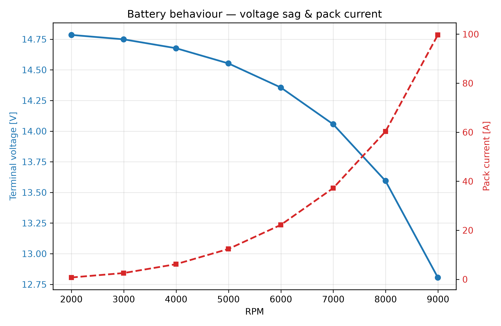
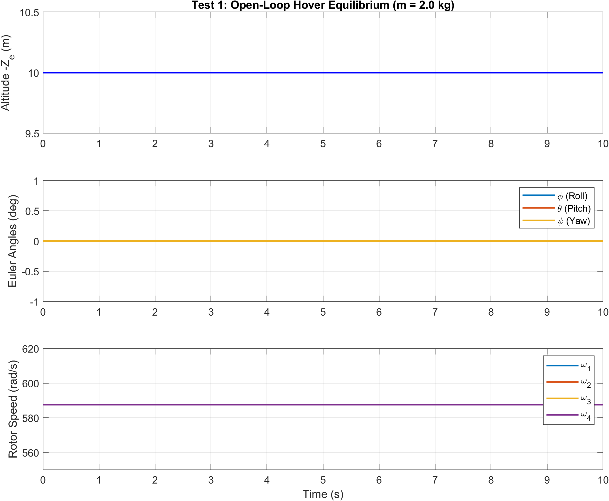
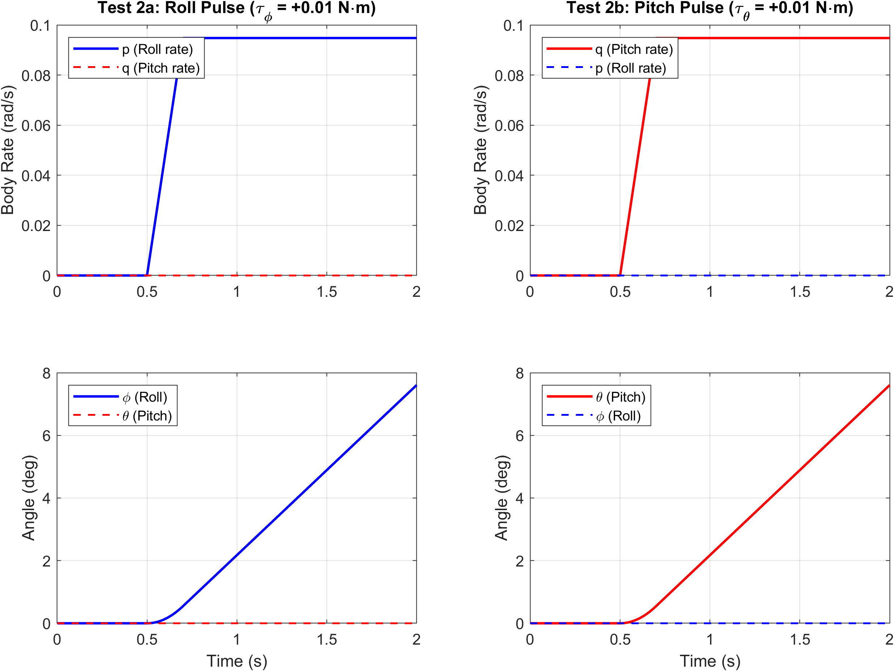
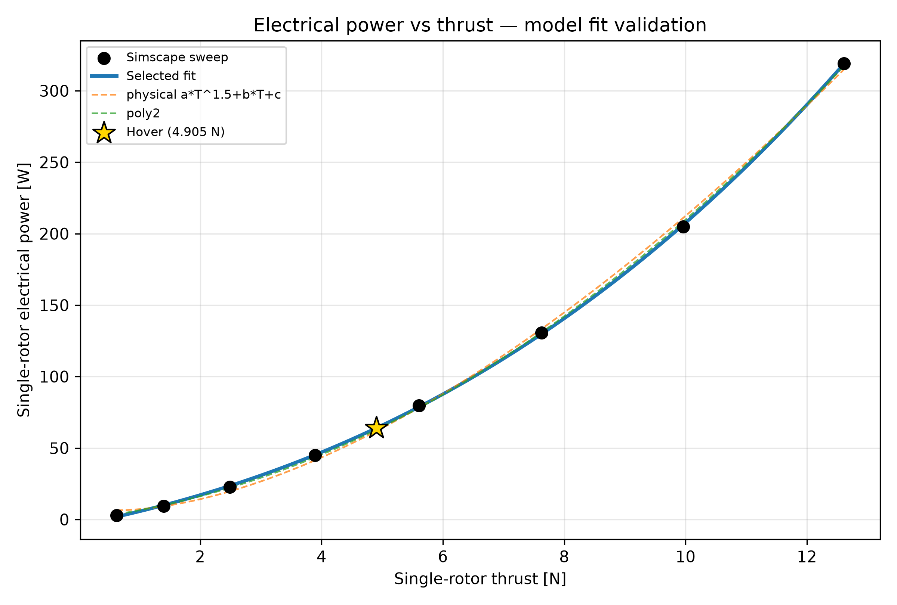
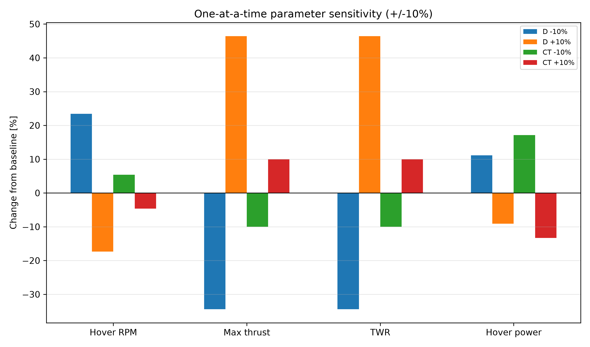
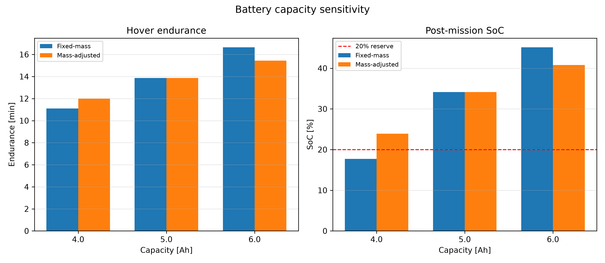

# Modular Verification of a 2 kg Quadrotor: Propulsion, Six-Degree-of-Freedom Dynamics, Mission Energy, and PX4 Cross-Simulation

**Author:** Pranav Sharma Oleti — Quadrotor System Modelling Project, Department of Mechanical Engineering
**Date:** 25 November 2026

---

## Abstract

This paper presents a modular verification framework for a 2.00 kg quadrotor unmanned aerial vehicle, developed to replace two legacy Simulink models whose parameter and structural defects precluded reliable flight-dynamics prediction. The methodology couples a corrected Simscape propulsion model, an independently derived analytical verification protocol, a clean six-degree-of-freedom rigid-body plant, system-level mission analysis, and a simulation-to-simulation cross-comparison against PX4 Software-In-The-Loop telemetry. An eight-point steady operating sweep was verified against momentum theory with maximum thrust, torque, and shaft-power errors of 0.0073 %, 0.0031 %, and 0.0032 %. The fitted single-rotor electrical model yields 256.1 W total hover power at the 4.905 N per-rotor trim condition. A four-phase mission of 670 s consumes 47.72 Wh and finishes at 34.15 % state of charge, above the 20 % reserve. Replaying a matched 10° roll step through the six-degree-of-freedom plant gives a cross-simulator attitude RMSE of 0.629°, with PX4 rising in 0.33 s against 0.43 s for the plant. The results demonstrate that transparent first-principles modelling reproduces the closed-loop behaviour of a representative autopilot simulation while exposing controller and actuation differences that must be resolved before physical validation.

---

## Nomenclature

| Symbol | Description | SI unit |
|---|---|---|
| $\rho$ | Air density | kg·m$^{-3}$ |
| $D$ | Propeller diameter | m |
| $n$ | Rotational speed, RPM/60 | rev·s$^{-1}$ |
| $\omega$ | Rotor angular speed | rad·s$^{-1}$ |
| $T_i$, $Q_i$ | Single-rotor thrust, reaction torque | N, N·m |
| $C_T$, $C_Q$ | Thrust and torque coefficients | — |
| $k_f$, $k_m$ | Lumped rotor constants | N·s²·rad$^{-2}$, N·m·s²·rad$^{-2}$ |
| $m$, $g$ | Vehicle mass, gravitational acceleration | kg, m·s$^{-2}$ |
| $l$ | Centre-to-rotor arm length | m |
| $J$ | Inertia tensor | kg·m² |
| $\mathbf{R}_{be}$ | Body-to-earth direction cosine matrix | — |
| $\phi,\theta,\psi$ | Roll, pitch, yaw angles | rad |
| $p,q,r$ | Body angular rates | rad·s$^{-1}$ |
| $U_1\ldots U_4$ | Virtual thrust and moment inputs | N, N·m |
| $\mathbf{B}_{\text{eff}}$, $\mathbf{B}_{\text{mixer}}$ | Rotor effectiveness and inverse mixer | — |
| $P_{\text{shaft}}$, $P_{\text{elec}}$ | Mechanical and electrical power | W |
| $V_{\text{nom}}$, $C_{\text{bat}}$ | Nominal pack voltage, capacity | V, A·h |
| $R_0$, $R_m$ | Pack internal and motor winding resistance | $\Omega$ |
| $\eta$ | Efficiency | — |
| SoC | State of charge | % |

---

## 1. Introduction

Small unmanned aerial vehicles are increasingly designed through model-based workflows in which propulsion, airframe dynamics, and autopilot behaviour must be verified before hardware integration. Legacy models often accumulate undocumented parameter changes and opaque subsystem hierarchies, so their predictions cannot be traced to physical assumptions. The present work addresses this problem by replacing two such models with a transparent, modular verification chain whose every constant is derived from a frozen configuration and whose every result is reproducible from generated data.

Two legacy models motivated the effort. The first, an electro-mechanical propulsion model, contained rotor and electrical parameters representative of a heavy helicopter rather than a 2 kg quadrotor. The second, a flight-dynamics model, paired a 0.07 kg airframe with a 2.0 kg thrust profile and possessed no yaw authority. Rather than patching these foundations, the investigation built a clean replacement plant from first principles and used the legacy files only as archival audit evidence.

The problem statement is therefore: establish a verifiable, end-to-end modelling chain for a 2.00 kg plus-configuration quadrotor that (i) reconciles Simscape propulsion outputs with analytical momentum theory, (ii) produces a stable six-degree-of-freedom plant with geometric control allocation, (iii) quantifies payload, sensitivity, and mission-energy margins, and (iv) compares the plant's closed-loop response with a representative autopilot simulation under an identical command.

The numbered objectives are:

1. Freeze a physically consistent airframe, propulsion, and battery configuration and audit both legacy models.
2. Correct the propulsion model, execute an eight-point operating sweep, and verify it analytically.
3. Implement a six-degree-of-freedom rigid-body plant and pass five mandatory verification tests.
4. Characterise payload margin, parametric sensitivity, and four-phase mission energy.
5. Compare the plant with PX4 Software-In-The-Loop telemetry under a matched attitude step, strictly as a simulation-to-simulation exercise.

---

## 2. System Architecture & Mathematical Formulation

### 2.1 Baseline Quadrotor Configuration

The configuration was frozen before any simulation work. All values are design specifications, representative component specifications, analytical derivations, or tuned simulation baselines; none is claimed as hardware-validated.

| Subsystem | Parameter | Value | Source classification |
|---|---|---|---|
| Airframe | Baseline mass $m$ | 2.00 kg | Design specification |
| Airframe | Arm length $l$ | 0.225 m | Design specification |
| Airframe | Inertia $J=\text{diag}(I_{xx},I_{yy},I_{zz})$ | (0.021, 0.021, 0.040) kg·m² | Design specification |
| Airframe | Drag matrix $D_{\text{drag}}$ | $\text{diag}(0,0,0)$ | Intentional omission |
| Motor | Speed constant, winding resistance | 920 KV, 0.085 $\Omega$ | Representative component spec |
| Motor | Torque constant $K_t$ | 0.0104 N·m·A$^{-1}$ | Analytically derived |
| Motor / propeller | Rotor inertias $J_m$, $J_p$ | 1.5×10$^{-5}$, 5.0×10$^{-5}$ kg·m² | Representative component spec |
| Propeller | Diameter $D$ | 0.254 m | Design specification |
| Propeller | $C_T$, $C_Q$ | 0.110, 0.0090 | Representative component spec |
| Battery | Configuration, $V_{\text{nom}}$, $C_{\text{bat}}$ | 4S LiPo, 14.8 V, 5.0 A·h | Design specification |
| Battery | Pack resistance $R_0$ | 0.020 $\Omega$ | Design specification |
| ESC | Efficiency $\eta_{\text{ESC}}$ | 0.95 | Design specification |
| Bridge | $k_f$, $k_m$ | 1.421×10$^{-5}$, 2.952×10$^{-7}$ | Analytically derived, sweep-verified |

The analytical bridge constants couple the propulsion formulation in revolutions per second to the flight-dynamics formulation in radians per second:

$$
k_f=\frac{C_T\rho D^4}{4\pi^2},\qquad k_m=\frac{C_Q\rho D^5}{4\pi^2}.
$$

At the frozen baseline these give $\omega_{\text{hover}}=587.6\ \text{rad·s}^{-1}$ (5611 RPM), a maximum static thrust of 50.48 N, and a thrust-to-weight ratio of 2.573.

### 2.2 Electro-Mechanical Propulsion Model

The corrected Simscape model contains a shared 4S LiPo pack, four 920 KV brushless motors with winding resistance, four 10-inch propellers, and electronic speed controllers with fixed conversion efficiency. The analytical relations evaluated at each steady operating point are numbered below.

$$
n=\frac{\text{RPM}}{60}
$$

$$
T_{\text{an}}=C_T\rho n^2 D^4
$$

$$
Q_{\text{an}}=C_Q\rho n^2 D^5
$$

$$
P_{\text{shaft,an}}=Q_{\text{an}}\,(2\pi n)
$$

$$
P_{\text{elec}}=V_{\text{term}}\,I_{\text{motor}}
$$

The difference $P_{\text{elec}}-P_{\text{shaft}}$ is attributed to stator copper loss $I_m^2R_m$, ESC conversion loss $(1-\eta_{\text{ESC}})P_{\text{elec}}$, and mechanical friction. The same bridge constants feed the flight-dynamics plant through $T_i=k_f\omega_i^2$ and $Q_i=k_m\omega_i^2$.

### 2.3 Six-Degree-of-Freedom Flight Dynamics and Control Allocation

The plant uses the Aerospace Blockset `6DOF (Euler Angles)` rigid-body block in Metric (MKS) units, integrating the twelve-state vector. The body frame is Forward–Right–Down and the earth frame is flat North–East–Down. Gravity is applied through the body-frame transformation

$$
\mathbf{F}_{g,b}=\mathbf{R}_{be}\begin{bmatrix}0\\0\\mg\end{bmatrix}.
$$

For the plus configuration with rotor 1 front (counter-clockwise), rotor 2 left (clockwise), rotor 3 rear (counter-clockwise), and rotor 4 right (clockwise), the effectiveness matrix is

$$
\mathbf{B}_{\text{eff}}=
\begin{bmatrix}
k_f & k_f & k_f & k_f\\
0 & l k_f & 0 & -l k_f\\
l k_f & 0 & -l k_f & 0\\
k_m & -k_m & k_m & -k_m
\end{bmatrix},
\qquad
\begin{bmatrix}\omega_1^2&\omega_2^2&\omega_3^2&\omega_4^2\end{bmatrix}^T
=\mathbf{B}_{\text{eff}}^{-1}
\begin{bmatrix}U_1&U_2&U_3&U_4\end{bmatrix}^T .
$$

Each squared-speed command is saturated to $[0,\omega_{\max}^2]$ before the square root is taken. The baseline single-loop proportional–derivative laws are

$$
U_1=\frac{mg+K_{p,z}(z_{\text{ref}}-z)-K_{d,z}w}{\cos\phi\cos\theta},
$$

$$
U_2=K_{p,\phi}(\phi_{\text{ref}}-\phi)-K_{d,\phi}p,\quad
U_3=K_{p,\theta}(\theta_{\text{ref}}-\theta)-K_{d,\theta}q,\quad
U_4=K_{p,\psi}(\psi_{\text{ref}}-\psi)-K_{d,\psi}r .
$$

Gains are $K_{p,z}=18.0$, $K_{d,z}=10.8$, $K_{p,\phi}=K_{p,\theta}=0.756$, $K_{d,\phi}=K_{d,\theta}=0.2142$, $K_{p,\psi}=0.640$, and $K_{d,\psi}=0.2880$. No handwritten integrator is used; the blockset supplies all state integration.

---

## 3. Verification Methodology

### 3.1 Legacy Model Audit and Retirement Rationale

Both legacy models were audited parameter-by-parameter. The propulsion model showed a 1.5 m, 10 kg helicopter-scale rotor, zero winding resistance, a 3.6 V single-cell battery assumption, inconsistent torque limits, and unverified clockwise/counter-clockwise routing. The flight-dynamics model combined a 0.07 kg airframe with a 19.62 N thrust profile, set $k_m=0$, used non-geometric mixing blocks, and carried default controller gains. Because repairing the latter would have required reverse-engineering opaque frame conventions, it was preserved as evidence and retired in favour of a fresh implementation.

### 3.2 Propulsion Sweep and Analytical Verification Protocol

Eight steady operating points from 1999 to 8996 RPM were extracted from the corrected propulsion model. At each point, simulated thrust, torque, shaft power, current, and terminal voltage were compared with the analytical relations of Section 2.2. Percentage errors were computed point-wise, the lumped constants were recomputed from first principles and checked against the initialization script, and an assertion required electrical power to exceed shaft power at every point. Five 300-DPI figures were generated for visual inspection.

### 3.3 Six-Degree-of-Freedom Five-Test Verification Matrix

| Test | Condition | Quantity verified |
|---|---|---|
| 1 | Open-loop equal thrust, $m=2.00$ kg | Constant 10.0 m altitude, zero attitude acceleration |
| 2 | Separate +0.01 N·m roll and pitch pulses | Correct axis response, negligible cross-coupling |
| 3 | +0.02 N·m yaw reaction-torque pulse | Yaw acceleration and angle with flat altitude |
| 4 | Masses 2.0, 2.5, 3.0 kg | Hover thrust, speed, thrust margin, and TWR scaling |
| 5 | Closed-loop 10° roll and pitch step | Convergent PD response with bounded rotor speeds |

### 3.4 Mission-Energy and Parametric Sensitivity Framework

A cubic polynomial was fitted to single-rotor electrical power versus thrust and compared with a momentum-theory-motivated form; the strictly monotonic fit with the lower root-mean-square error was retained. Payload and thrust margins were evaluated for three masses and a finer 1.5–3.5 kg sweep. One-at-a-time ±10 % perturbations of diameter and thrust coefficient were applied to the 2.00 kg baseline. Mission energy was integrated over the blueprint's four phases using coulomb counting for state of charge, and battery capacities of 4.0, 5.0, and 6.0 A·h were evaluated both at fixed mass and with a 0.10 kg per A·h mass penalty.

### 3.5 PX4 Cross-Simulation Protocol

A +10° roll step was flown in PX4 Software-In-The-Loop with the standard `gz_x500` vehicle. Telemetry was extracted from the logged ULog file, converted from quaternion to Z–Y–X Euler angles, windowed from one second before the step to five seconds after the hold, and resampled at 100 Hz. The setpoint sequence was replayed through the six-degree-of-freedom plant with the test selector set to seven. Both systems operate in Forward–Right–Down body and North–East–Down local frames, so no legacy North-West-Up sign inversion was applied; the only normalization was to express yaw relative to the window-start heading. The exercise is strictly a simulation-to-simulation cross-comparison and provides no experimental flight validation.

---

## 4. Results

### 4.1 Propulsion Characterisation

The eight-point sweep spans 0.623 N to 12.609 N single-rotor thrust. Terminal voltage falls from 14.79 V to 12.81 V as pack current rises to 99.69 A, directly demonstrating load-dependent voltage sag. Maximum absolute errors relative to analytical momentum theory are 0.0073 % in thrust, 0.0031 % in torque, and 0.0032 % in shaft power. Overall efficiency decreases from 98.1 % at the lowest load to 77.3 % at the highest, and electrical power exceeds shaft power at every point.

| RPM | $n$ (rev/s) | $\omega$ (rad/s) | $T$ (N) | $Q$ (N·m) | $P_{\text{shaft}}$ (W) | $I_{\text{pack}}$ (A) | $V_{\text{term}}$ (V) | $P_{\text{elec}}$ (W) |
|---|---|---|---|---|---|---|---|---|
| 1999 | 33.32 | 209.4 | 0.623 | 0.01294 | 2.710 | 0.747 | 14.79 | 2.762 |
| 2999 | 49.98 | 314.0 | 1.401 | 0.02911 | 9.141 | 2.555 | 14.75 | 9.419 |
| 3998 | 66.64 | 418.7 | 2.491 | 0.05176 | 21.67 | 6.170 | 14.68 | 22.64 |
| 4998 | 83.30 | 523.4 | 3.892 | 0.08088 | 42.33 | 12.37 | 14.55 | 45.01 |
| 5997 | 99.96 | 628.1 | 5.604 | 0.1165 | 73.15 | 22.18 | 14.36 | 79.62 |
| 6997 | 116.6 | 732.7 | 7.628 | 0.1585 | 116.2 | 37.18 | 14.06 | 130.6 |
| 7997 | 133.3 | 837.4 | 9.963 | 0.2070 | 173.4 | 60.28 | 13.59 | 204.9 |
| 8996 | 149.9 | 942.1 | 12.61 | 0.2620 | 246.9 | 99.69 | 12.81 | 319.2 |

*Figure 1. Simulated and analytical single-rotor thrust across the operating sweep.*

*Figure 2. Simulated and analytical single-rotor reaction torque across the operating sweep.*

*Figure 3. Single-rotor shaft and electrical power against thrust; the marker denotes the 4.905 N hover trim at 64.03 W.*

*Figure 4. Terminal-voltage sag and pack current against rotor speed.*

### 4.2 Six-Degree-of-Freedom Flight Dynamics Verification

*Figure 5. Test 1, open-loop hover equilibrium at 587.6 rad·s$^{-1}$ and 10.0 m.*

*Figure 6. Test 2, separate roll and pitch pulses of +0.01 N·m.*

*Figure 7. Test 3, pure yaw reaction-torque response to a +0.02 N·m pulse.*

| Mass (kg) | Hover thrust (N) | Hover speed (rad/s) | Hover speed (RPM) | TWR | Margin (N) |
|---|---|---|---|---|---|
| 2.0 | 19.62 | 587.6 | 5611 | 2.573 | 30.86 |
| 2.5 | 24.53 | 656.9 | 6273 | 2.058 | 25.95 |
| 3.0 | 29.43 | 719.6 | 6872 | 1.715 | 21.05 |

*Table 1. Test 4 payload equilibrium for the three mandatory mass cases.*

*Figure 8. Test 4, altitude and rotor-speed response for the three payload cases.*

*Figure 9. Test 5, closed-loop proportional–derivative tracking of a 10° step. Tilt compensation raises total thrust to 20.24 N, equivalent to 596.7 rad·s$^{-1}$; Euler kinematics produce a 0.559° yaw transient that the loop corrects.*

### 4.3 Payload Margin, Sensitivity, and Mission Energy

The selected electrical fit was cubic, with $R^2=0.999935$ and RMSE 0.838 W. Fitted hover power is 64.03 W per rotor, or 256.1 W total, positioned between the 5000 and 6000 RPM sweep points.

*Figure 10. Electrical power against thrust with the selected fit and hover operating point.*

| Mass (kg) | Added payload (kg) | Total thrust (N) | Per rotor (N) | RPM | TWR | Margin (N) | Electrical power (W) | Endurance (min) |
|---|---|---|---|---|---|---|---|---|
| 2.0 | 0.0 | 19.62 | 4.905 | 5611 | 2.573 | 30.86 | 256.1 | 13.87 |
| 2.5 | 0.5 | 24.53 | 6.131 | 6273 | 2.058 | 25.95 | 363.1 | 9.783 |
| 3.0 | 1.0 | 29.43 | 7.358 | 6872 | 1.715 | 21.05 | 488.8 | 7.267 |

*Table 2. Payload and thrust-margin study; hover speed and TWR agree with the flight-dynamics test to within 0.0005 %.*

*Figure 11. Thrust-to-weight ratio, thrust margin, hover power, and endurance against vehicle mass.*

| Case | $D$ (m) | $C_T$ | Hover RPM | Max thrust (N) | TWR | Hover power (W) |
|---|---|---|---|---|---|---|
| Baseline | 0.254 | 0.110 | 5611 | 50.48 | 2.573 | 256.1 |
| $D-10\%$ | 0.229 | 0.110 | 6927 | 33.12 | 1.688 | 284.6 |
| $D+10\%$ | 0.279 | 0.110 | 4637 | 73.91 | 3.767 | 232.8 |
| $C_T-10\%$ | 0.254 | 0.099 | 5914 | 45.43 | 2.316 | 300.0 |
| $C_T+10\%$ | 0.254 | 0.121 | 5350 | 55.53 | 2.830 | 222.0 |

*Table 3. One-at-a-time ±10 % parameter sensitivity.*

*Figure 12. Percentage change in hover speed, maximum thrust, thrust-to-weight ratio, and hover power.*

| Phase | Duration (s) | Multiplier | Total thrust (N) | Power (W) | Pack current (A) | Phase energy (Wh) | Cumulative (Wh) | SoC (%) |
|---|---|---|---|---|---|---|---|---|
| Take-off | 5 | 1.15 | 22.56 | 318.1 | 22.02 | 0.442 | 0.442 | 99.39 |
| Climb | 30 | 1.08 | 21.19 | 288.4 | 19.92 | 2.403 | 2.845 | 96.07 |
| Hover | 600 | 1.00 | 19.62 | 256.1 | 17.67 | 42.68 | 45.53 | 37.18 |
| Descent | 35 | 0.92 | 18.05 | 225.6 | 15.55 | 2.193 | 47.72 | 34.15 |
| Total | 670 | — | — | — | — | 47.72 | 47.72 | 34.15 |

*Table 4. Four-phase mission profile; total energy is 171.8 kJ and the final state of charge clears the 20 % reserve.*

*Figure 13. Piecewise-constant thrust and power with linearly accumulating energy and linearly decreasing state of charge.*

| Case | Capacity (A·h) | Mass (kg) | Endurance (min) | Mission energy (Wh) | Post-mission SoC (%) | Reserve met |
|---|---|---|---|---|---|---|
| Fixed mass | 4.0 | 2.00 | 11.10 | 47.72 | 17.69 | No |
| Mass adjusted | 4.0 | 1.90 | 12.00 | 44.13 | 23.92 | Yes |
| Fixed mass | 5.0 | 2.00 | 13.87 | 47.72 | 34.15 | Yes |
| Mass adjusted | 5.0 | 2.00 | 13.87 | 47.72 | 34.15 | Yes |
| Fixed mass | 6.0 | 2.00 | 16.64 | 47.72 | 45.13 | Yes |
| Mass adjusted | 6.0 | 2.10 | 15.44 | 51.44 | 40.80 | Yes |

*Table 5. Battery-capacity sensitivity with and without the 0.10 kg per A·h mass penalty.*

*Figure 14. Hover endurance and post-mission state of charge versus pack capacity.*

### 4.4 PX4 SITL versus Simulink Six-Degree-of-Freedom Cross-Simulation

The matched maneuver was a +10° roll step held for 8.06 s within a 14.01 s aligned window. The following tables separate steady-state tracking from transient response so that no column is clipped.

| Axis | PX4 RMSE vs setpoint (°) | Plant RMSE vs setpoint (°) | Cross-simulator RMSE (°) | PX4 steady error (°) | Plant steady error (°) |
|---|---|---|---|---|---|
| Roll | 1.968 | 1.539 | 0.629 | 0.074 | 0.217 |
| Pitch | 0.322 | `$\approx$`{=latex}0 | 0.322 | 0.594 | `$\approx$`{=latex}0 |
| Yaw | 1.849 | `$\approx$`{=latex}0 | 1.849 | −3.045 | `$\approx$`{=latex}0 |

*Table 6. Tracking and steady-state error metrics.*

| Axis | PX4 overshoot (%) | Plant overshoot (%) | PX4 rise (s) | Plant rise (s) | PX4 settle 2 % (s) | Plant settle 2 % (s) | PX4 peak rate (rad/s) | Plant peak rate (rad/s) |
|---|---|---|---|---|---|---|---|---|
| Roll | 10.57 | 0.627 | 0.33 | 0.43 | 5.33 | 0.69 | 0.536 | 0.426 |
| Pitch | — | — | — | — | — | — | 0.018 | `$\approx$`{=latex}0 |
| Yaw | — | — | — | — | — | — | 0.090 | `$\approx$`{=latex}0 |

*Table 7. Transient step-response metrics. All values derive from simulated traces; no flight-test data are involved.*

*Figure 15. Setpoint, PX4 simulation, and plant response for roll, pitch, and yaw.*

*Figure 16. Body angular rates for the two simulated systems.*

*Figure 17. Roll tracking error and altitude-hold comparison.*

---

## 5. Synthesis & Discussion

### 5.1 Propulsion Efficiency and Battery Accounting

Overall efficiency falls from 98.1 % at 1999 RPM to 77.3 % at 8996 RPM because stator copper loss scales with the square of motor current and the pack voltage sags under load. Terminal voltage drops from 14.79 V to 12.81 V while pack current rises to 99.69 A, so the same delivered watt-hour demand withdraws more ampere-hours than a fixed 14.8 V ratio predicts. Coulomb counting therefore yields a mission end state of charge of 34.15 %, slightly below the value implied by dividing consumed energy by nominal pack energy. This distinction is deliberate: the reported value follows charge withdrawn from the pack, not an idealised constant-voltage energy ratio.

### 5.2 Disk-Loading Scaling and Battery Mass Trade-off

Because $k_f\propto C_T D^4$ and $k_m\propto C_Q D^5$, maximum static thrust scales as $D^4$, hover speed as $D^{-2}$, and hover shaft power as $D^{-1}$. The ±10 % sweep confirms the trend: enlarging the diameter by 10 % lowers hover speed from 5611 to 4637 RPM and hover power from 256.1 to 232.8 W while raising maximum thrust from 50.48 to 73.91 N. Conversely, thrust coefficient changes thrust and speed but not reaction torque, so power changes follow through aerodynamic load alone. Battery capacity increases hover endurance from 11.10 to 16.64 minutes at fixed mass, but adding 0.10 kg per A·h reduces the gain to 12.00–15.44 minutes, quantifying diminishing returns.

### 5.3 Reconciliation of the Two Simulated Dynamic Systems

PX4 Software-In-The-Loop employs a cascaded attitude-proportional and angular-rate-PID architecture with rate limiting and feedforward; the plant uses a single-loop proportional–derivative law. The inner rate loop explains PX4's faster 0.33 s rise and larger 10.57 % overshoot, whereas the plant rises in 0.43 s with 0.63 % overshoot and settles to 2 % in 0.69 s against 5.33 s. Gazebo adds motor lag, aerodynamic drag, and estimator noise, while the plant uses static quadratic rotors, instantaneous speed response, and zero drag. The 0.629° cross-simulator roll RMSE shows that these structural differences do not prevent close agreement under a matched command.

### 5.4 Limitations

The plant assumes static rotor thrust and torque, omits aerodynamic drag, and uses ideal sensors and actuation. The PX4 log used for comparison records the step at approximately 0.04 m above ground with near-zero distance-to-ground, so ground effect and possible saturation make the altitude-hold comparison non-equivalent. All results remain simulation-based; no experimental flight validation is claimed or implied.

---

## 6. Conclusions & Future Work

The five objectives of Section 1 are addressed as follows. A frozen, source-classified configuration was established and both legacy models were audited (Objective 1). The corrected propulsion model passed eight-point analytical verification with sub-0.01 % errors (Objective 2). The six-degree-of-freedom plant passed all five verification tests, including convergent closed-loop tracking of a 10° step (Objective 3). Payload, sensitivity, and four-phase mission studies quantified a 2.573 baseline thrust-to-weight ratio, 47.72 Wh mission energy, and 34.15 % final state of charge (Objective 4). Finally, the matched PX4 replay produced a 0.629° cross-simulator roll RMSE and transparently documented controller and actuation differences (Objective 5).

Future work should add first-order motor and electronic-speed-controller dynamics to the plant, introduce identified aerodynamic drag coefficients, and repeat the flight-dynamics and mission studies. A PX4 Software-In-The-Loop scenario with confirmed in-air altitude above 2 m is required before treating the cross-comparison as representative of flight conditions; hardware-in-the-loop or controlled flight testing would be needed for physical validation.

---

## References

1. MathWorks, *Aerospace Blockset User's Guide*, 6DOF (Euler Angles) block documentation.
2. MathWorks, *Simscape User's Guide*, electrical and mechanical domain modelling documentation.
3. PX4 Autopilot Developer Documentation, *ULog File Format* and *Attitude Setpoint* topics.
4. Gazebo Simulator Documentation, *Sensors and Model Plugins*.
5. Bouabdallah, A., Noth, A., and Siegwart, R., “PID vs LQ Control Techniques Applied to an Indoor Micro Quadrotor,” *IEEE/RSJ International Conference on Intelligent Robots and Systems*, 2004.
6. Stevens, B. L. and Lewis, F. L., *Aircraft Control and Simulation*, 2nd ed., Wiley, 2003.
7. Corke, P., *Robotics, Vision and Control*, 2nd ed., Springer, 2017.

---

## Appendix A. Archival Traceability and Legacy Defect Register

This appendix records the repository locations of all evidence artefacts and the detailed legacy audit. File paths appear here only.

### A.1 Evidence locations

- Configuration: configuration/vehicle_configuration.md, configuration/parameter_register_and_audit.csv, configuration/component_sources.md, Step 4 architecture decision note.
- Models: models/original/, models/modified/, models/new_build/.
- Propulsion: the operating-point sweep, verification script and summary, and propulsion plots under propulsion_analysis/.
- Flight dynamics: flight_dynamics_6dof/test1_hover_equilibrium/ through test5_pd_control_response/.
- Mission analysis: mission_analysis/run_mission_analysis.py, mission_analysis/*.csv, mission_analysis/plots/.
- Cross-simulation: px4_comparison/extracted_csv/, px4_comparison/scripts/, px4_comparison/comparison_results/.
- Report build: report/build_report.py.

### A.2 Traceability matrix

| Objective | Primary evidence |
|---|---|
| Configuration and audit | Parameter register and architecture decision note |
| Propulsion | Sweep table, verification summary, five propulsion figures |
| Flight dynamics | Five test folders and Test 4 summary |
| Mission analysis | Four mission CSV tables and five mission figures |
| Cross-simulation | Aligned telemetry, replay CSV, metrics table, three comparison figures |

### A.3 Legacy defect register

| Legacy model | Defect | Resolution |
|---|---|---|
| Electro-mechanical propulsion | 1.5 m, 10 kg helicopter-scale rotor | Replaced with 0.254 m, 10-inch rotor |
| Electro-mechanical propulsion | Zero winding resistance | Set to 0.085 $\Omega$ |
| Electro-mechanical propulsion | 3.6 V single-cell pack | Replaced with 14.8 V 4S pack, 0.020 $\Omega$ |
| Electro-mechanical propulsion | Opposing spin and thrust cancellation | CW/CCW routing verified |
| Flight-dynamics baseline | 0.07 kg mass against 19.62 N thrust | Model retired and preserved unmodified |
| Flight-dynamics baseline | $k_m=0$, no yaw authority | Replaced by $k_m=2.952\times10^{-7}$ |
| Flight-dynamics baseline | Non-geometric mixing and default gains | Replaced by derived mixer and tuned PD gains |
