# Quadrotor UAV Engineering Investigation — Final Technical Report

**Project:** Quadrotor System Modelling / Cross-Simulation
**Repository evidence:** `Quadrotor_System_Modelling` (branch `main`)
**Scope:** Seven-step model audit, propulsion characterisation, 6-DoF flight dynamics, mission analysis and PX4 SITL cross-simulation.
**Reporting rule:** All quantitative results are reproduced from generated CSV/JSON artefacts in this repository. Every comparison in Section 6 is a **simulation-to-simulation cross-comparison**; no experimental flight validation is claimed.

---

## 1. Executive Summary & System Overview

This investigation delivers an integrated, traceable engineering verification of a 2.00 kg-class quadrotor UAV across seven work packages. Rather than coupling legacy Simulink models in real time, a modular verification architecture was implemented:

1. **Model audit and reimplementation (Steps 1 & 4).** Both legacy models were audited. `ElectroMechanics_Q.slx` was corrected and saved as `models/modified/ElectroMechanics_Q_modified.slx`; `HoverLock.slx` was retired as an unreliable baseline and replaced by a clean `Quadrotor_6DoF.slx` built around the Aerospace Blockset `6DOF (Euler Angles)` plant, a derived 4×4 allocator and a baseline PD controller.
2. **Propulsion characterisation (Steps 2 & 3).** An 8-point steady operating sweep (1999.3–8996.08 RPM) was extracted from the Simscape model and independently verified against analytical momentum theory. Thrust error ≤ 0.007 %, torque error ≤ 0.003 %, shaft-power error ≤ 0.003 %; `P_elec > P_shaft` at all 8 points.
3. **Flight dynamics and performance (Steps 5 & 6).** Five mandatory 6-DoF verification tests were executed. A cubic electrical power fit (`R² = 0.999935`, RMSE `0.8381 W`) supported payload, sensitivity and 4-phase mission-energy studies: 47.72 Wh mission energy, coulomb-counted final SoC 34.15 %.
4. **PX4 cross-simulation (Step 7).** A logged +10° roll step from PX4 SITL (Gazebo `gz_x500`) was replayed through the 6-DoF plant. Roll cross-simulator RMSE was **0.629°**, with PX4 rise time 0.33 s versus Simulink 0.43 s.

### Traceability matrix (resume claims → evidence)

| Claim | Evidence in this repository |
|---|---|
| Audit, refinement, control allocation | `configuration/parameter_register_and_audit.csv`, `configuration/Quadrotor_Step4_Architecture_Decision_Note.md`, `models/original/`, `models/modified/`, `models/new_build/Quadrotor_6DoF.slx` |
| Propulsion characterisation | `propulsion_analysis/operating_point_sweep.csv`, `propulsion_analysis/verification_calculations.py`, 5 verification plots |
| Flight dynamics, payload, mission | `flight_dynamics_6dof/`, `mission_analysis/*.csv`, 5 mission plots |
| PX4 cross-simulation | `px4_comparison/ulog/`, `px4_comparison/scripts/`, `px4_comparison/comparison_results/` |

---

## 2. Vehicle Configuration & Legacy Model Audit (Step 1)

### 2.1 Frozen configuration and source classifications

The baseline configuration is frozen in `configuration/vehicle_configuration.md` and `models/new_build/init_6dof_params.m`. Source classifications follow `configuration/parameter_register_and_audit.csv` and `configuration/component_sources.md`; every value is a design specification, a representative component specification, an analytical derivation or a tuned simulation baseline — none is claimed as hardware-validated.

| Subsystem | Parameter | Value | Source classification |
|---|---|---|---|
| Airframe | Baseline mass `m` | 2.00 kg | Design Specification |
| Airframe | Arm length `l` | 0.225 m | Design Specification |
| Airframe | Inertia `J` | diag(0.021, 0.021, 0.040) kg·m² | Design Specification |
| Motor | Speed constant / winding resistance | 920 KV / 0.085 Ω | Representative Component Spec |
| Propeller | Diameter / coefficients | 0.254 m / `C_T` 0.110, `C_Q` 0.0090 | Design / Representative Spec |
| Battery | 4S LiPo, nominal voltage / capacity | 14.8 V / 5.0 Ah (74.0 Wh) | Design Specification |
| Battery | Pack internal resistance `R_0` | 0.020 Ω | Design Specification |
| ESC | Efficiency `η_ESC` | 0.95 | Design Specification |
| Bridge | `kf`, `km` | 1.420705e-5, 2.952483e-7 | Analytically Derived, sweep-verified |

Analytical bridge constants (from `init_6dof_params.m`):

```
rho = 1.225 kg/m^3
kf  = (CT * rho * D^4) / (4*pi^2) = 1.420705e-5 N/(rad/s)^2
km  = (CQ * rho * D^5) / (4*pi^2) = 2.952483e-7 N*m/(rad/s)^2
omega_hover = sqrt(m*g/(4*kf)) = 587.58 rad/s  (5611.0 RPM)
```

### 2.2 Audit of `ElectroMechanics_Q.slx`

Five physical defects were corrected in `models/modified/ElectroMechanics_Q_modified.slx`:

1. **Helicopter-scale rotor:** propeller diameter `D = 1.5 m` and mass `10 kg` replaced with the 0.254 m (10-inch) UAV rotor class.
2. **Zero winding resistance:** `R_m = 0 Ω` replaced with `0.085 Ω`, enabling `I²R` copper loss.
3. **Contradictory torque/power limits:** saturation limits made mutually consistent.
4. **Unphysical inertias:** `J_m = 1.5e-5 kg·m²`, `J_p = 5.0e-5 kg·m²` assigned to the rotating assembly.
5. **Unverified signal routing:** CW/CCW assignments and four-motor electrical connections verified.

The legacy 3.6 V single-cell battery assumption was replaced by the shared 14.8 V 4S pack with `R_0 = 0.020 Ω`, and opposing motor spin/thrust cancellation was resolved.

### 2.3 Audit of `HoverLock.slx` and retirement rationale

`HoverLock.slx` (preserved unmodified in `models/original/`) showed:

- mass `m = 0.07 kg` paired with a `19.62 N` / 2.0 kg thrust profile (≈28.6× imbalance);
- `km = 0`, eliminating yaw reaction torque;
- non-geometric `M1–M4` allocation blocks;
- default, uncalibrated PID gains and opaque frame conventions.

| Criterion | Repairing `HoverLock.slx` (rejected) | Fresh `Quadrotor_6DoF.slx` (selected) |
|---|---|---|
| Architecture | Reverse-engineer opaque blocks | Transparent, owned structure |
| Governing equations | Must be inferred | Explicit 12-state rigid-body plant |
| Mixer | Structurally defective `M1–M4` | Derived `B_eff` / `B_mixer` |
| Debugging | Hidden frame/sign risk | Predictable modular functions |
| Credibility | Patch untrusted baseline | Every term verifiable |

**Decision:** retire `HoverLock.slx`; build the replacement from first principles. Full rationale is in `configuration/Quadrotor_Step4_Architecture_Decision_Note.md`.

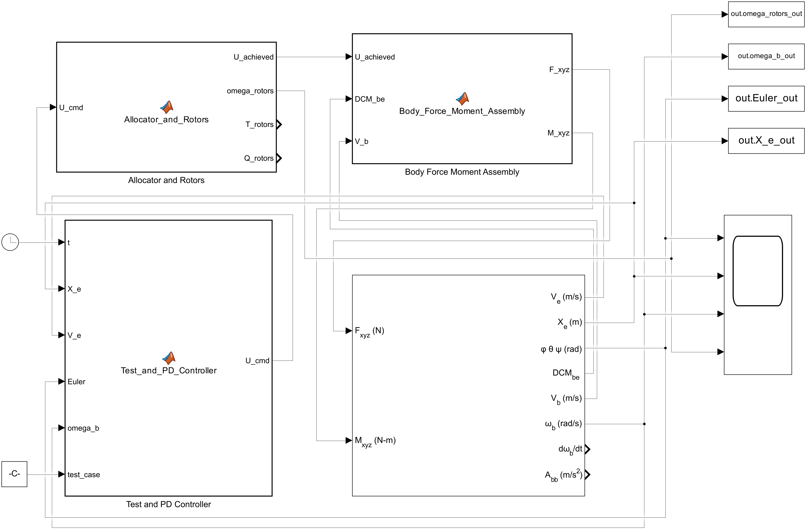
*Figure 1 — Quadrotor 6-DoF architecture (`configuration/Quadrotor_6DoF_architecture.png`).*

---

## 3. Electro-Mechanical Propulsion Modeling & Analytical Verification (Steps 2 & 3)

### 3.1 Simscape propulsion architecture

The corrected propulsion model comprises a shared 4S LiPo pack, four 920 KV BLDC motors with `R_m = 0.085 Ω`, four 10-inch propellers (`C_T = 0.110`, `C_Q = 0.0090`) and 95 % ESC efficiency. Figure 2–4 show the top-level and subsystem views preserved in `models/modified/`.

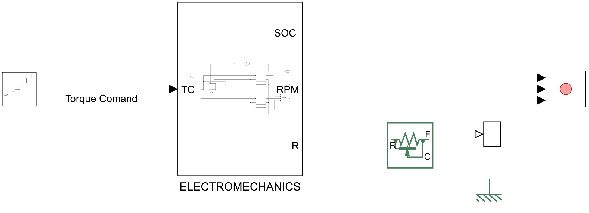
*Figure 2 — ElectroMechanics top-level model (`ElectroMechanics_top.png`).*

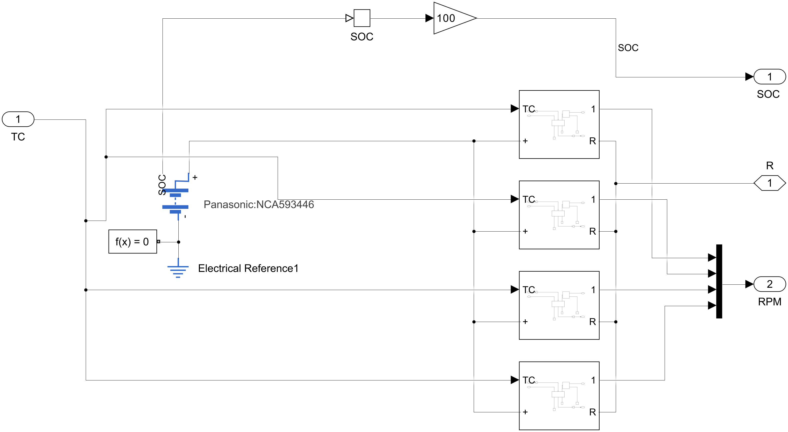
*Figure 3 — Electrical/mechanical subsystem view (`ElectroMechanics_sub.png`).*

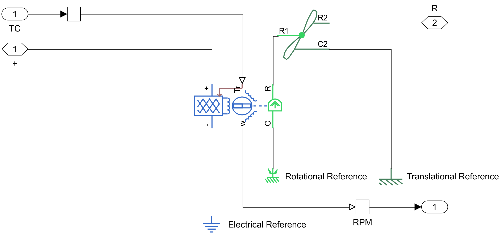
*Figure 4 — Motor/propeller subsystem view (`ElectroMechanics_motor_prop_sub.png`).*

### 3.2 Eight-point operating sweep and analytical verification

The simlog-extracted sweep `propulsion_analysis/operating_point_sweep.csv` contains eight steady points. The verification equations are:

```
n = RPM/60                       [rev/s]
T_an  = CT * rho * n^2 * D^4     [N]
Q_an  = CQ * rho * n^2 * D^5     [N*m]
P_shaft_an = Q_an * (2*pi*n)     [W]
P_elec = V_term * I_motor        [W]
```

| RPM | n (rev/s) | ω (rad/s) | Thrust (N) | Torque (N·m) | Shaft P (W) | Pack I (A) | Motor I (A) | V_term (V) | Motor P (W) | SoC (%) |
|---|---|---|---|---|---|---|---|---|---|---|
| 1999.30 | 33.3216 | 209.366 | 0.6228 | 0.012942 | 2.7097 | 0.7472 | 0.1868 | 14.7851 | 2.7619 | 99.983 |
| 2998.52 | 49.9753 | 314.004 | 1.4008 | 0.029112 | 9.1412 | 2.5545 | 0.6386 | 14.7489 | 9.4192 | 99.915 |
| 3998.22 | 66.6370 | 418.692 | 2.4905 | 0.051759 | 21.6712 | 6.1700 | 1.5425 | 14.6766 | 22.6387 | 99.748 |
| 4997.86 | 83.2977 | 523.375 | 3.8916 | 0.080877 | 42.3289 | 12.3706 | 3.0927 | 14.5526 | 45.0061 | 99.411 |
| 5997.48 | 99.9580 | 628.055 | 5.6040 | 0.116464 | 73.1459 | 22.1844 | 5.5461 | 14.3563 | 79.6216 | 98.804 |
| 6997.08 | 116.6180 | 732.733 | 7.6277 | 0.158522 | 116.1540 | 37.1772 | 9.2943 | 14.0565 | 130.6448 | 97.785 |
| 7996.67 | 133.2778 | 837.409 | 9.9628 | 0.207049 | 173.3848 | 60.2840 | 15.0710 | 13.5943 | 204.8801 | 96.130 |
| 8996.08 | 149.9347 | 942.068 | 12.6086 | 0.262036 | 246.8560 | 99.6936 | 24.9234 | 12.8061 | 319.1722 | 93.395 |

Analytical verification (`propulsion_verification_summary.csv`): maximum absolute thrust error **0.007 %**, torque error **0.003 %**, shaft-power error **0.003 %**. Efficiency `η_total = P_shaft / P_elec` ranges from `0.9811` at 1999 RPM down to `0.7734` at 8996 RPM, and `P_elec > P_shaft` holds at all eight points; the difference is `I²R` copper loss, ESC switching/conduction loss and mechanical friction. The lumped constants derived from `C_T`, `C_Q` agree with `init_6dof_params.m` to ~1e-13 relative.

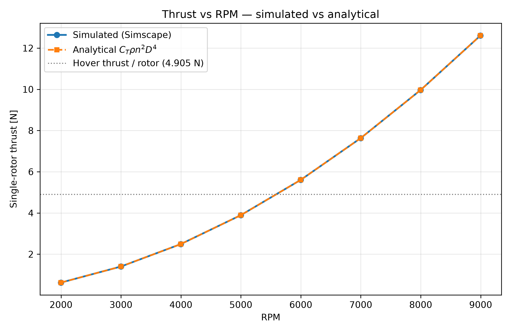
*Figure 5 — Simulated versus analytical single-rotor thrust (`thrust_vs_rpm.png`).*

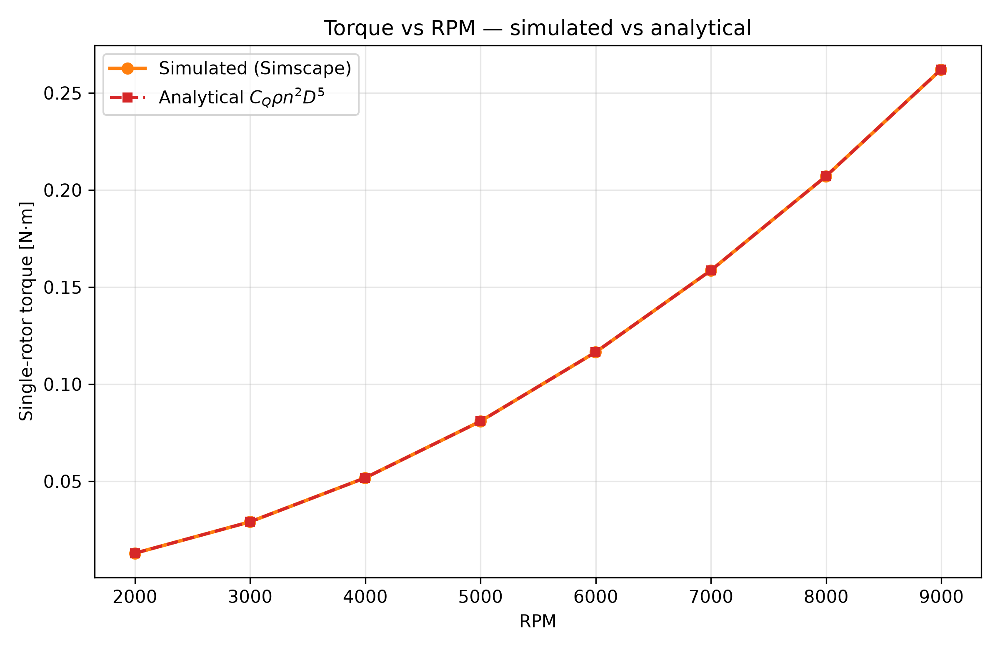
*Figure 6 — Simulated versus analytical single-rotor torque (`torque_vs_rpm.png`).*

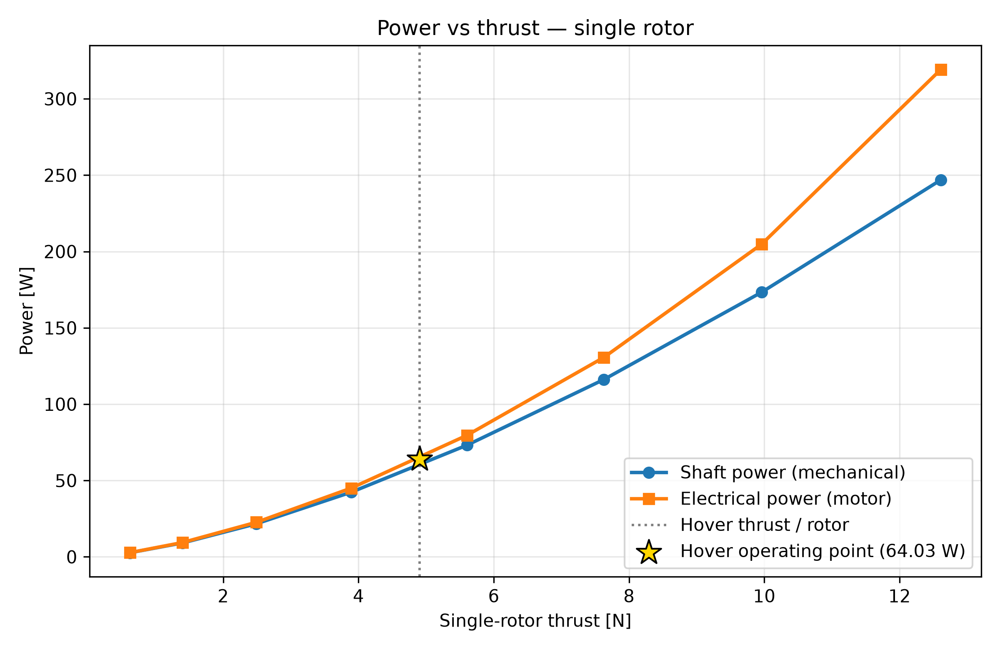
*Figure 7 — Single-rotor shaft and electrical power versus thrust, with hover marker (`power_vs_thrust.png`).*


*Figure 8 — Terminal-voltage sag and pack current versus RPM (`battery_behaviour.png`). Terminal voltage falls from 14.7851 V to 12.8061 V as pack current rises to 99.6936 A, the expected 4S LiPo sag under load.*

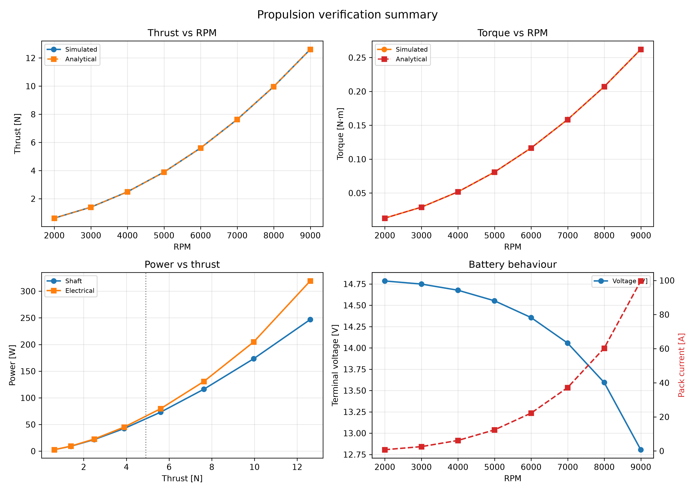
*Figure 9 — Combined 2×2 propulsion verification summary (`propulsion_verification_plots.png`).*

---

## 4. 6-DoF Flight Dynamics Architecture & Verification Tests (Steps 4 & 5)

### 4.1 Plant, frames and equations

The plant is the Aerospace Blockset `6DOF (Euler Angles)` block in Metric (MKS) units, integrating `[x, y, z, u, v, w, φ, θ, ψ, p, q, r]`. Body frame is FRD (+X forward, +Y right, +Z down); earth frame is flat NED. Gravity enters the body equations through `F_g,b = DCM_be · [0, 0, m·g]ᵀ`. No handwritten integrator is used; `D_drag = diag(0,0,0)` is an intentional omission.

```
B_eff = [ kf      kf      kf      kf
          0      l*kf     0     -l*kf
          l*kf     0    -l*kf     0
          km     -km      km    -km ]

omega_i_cmd^2 = B_mixer * [U1, U2, U3, U4]^T ,  B_mixer = inv(B_eff)
omega_i = sqrt( max(0, min(omega_max^2, omega_i_cmd^2)) )
```

Rotors: 1 Front CCW `[+l,0,0]`, 2 Left CW `[0,−l,0]`, 3 Rear CCW `[−l,0,0]`, 4 Right CW `[0,+l,0]`. Baseline PD gains (`init_6dof_params.m`): `Kp_z 18.0 / Kd_z 10.8`, `Kp_phi 0.756 / Kd_phi 0.2142`, `Kp_theta 0.756 / Kd_theta 0.2142`, `Kp_psi 0.640 / Kd_psi 0.2880`.

### 4.2 Five mandatory verification tests

**Test 1 — Hover equilibrium.** Open-loop equal thrust at `m = 2.00 kg`, `ω_i = 587.58 rad/s`, altitude 10.0 m held; no attitude acceleration.


*Figure 10 — Test 1 hover equilibrium (`test1_hover_equilibrium.png`).*

**Test 2a/2b — Roll and pitch pulses.** Separate +0.01 N·m pulses produce the corresponding body rate and angle with zero cross-axis response.


*Figure 11 — Test 2 roll/pitch pulse response (`test2_roll_pitch_response.png`).*

**Test 3 — Yaw reaction-torque pulse.** +0.02 N·m CCW/CW rotor split produces a pure yaw rate and angle progression with flat altitude (possible because `km = 2.952483e-7 ≠ 0`).

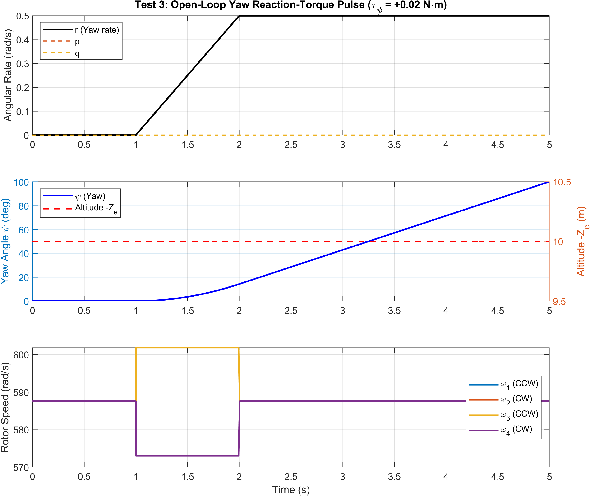
*Figure 12 — Test 3 yaw response (`test3_yaw_response.png`).*

**Test 4 — Payload equilibrium.** Three cases from `test4_payload_summary.csv`:

| Mass (kg) | Hover thrust (N) | Hover ω (rad/s) | Hover RPM | TWR | Thrust margin (N) |
|---|---|---|---|---|---|
| 2.0 | 19.62 | 587.580742984196 | 5610.9827826926 | 2.57280663300917 | 30.85846613964 |
| 2.5 | 24.525 | 656.935241791248 | 6273.26946134079 | 2.05824530640734 | 25.95346613964 |
| 3.0 | 29.43 | 719.636501498354 | 6872.02238656927 | 1.71520442200612 | 21.04846613964 |

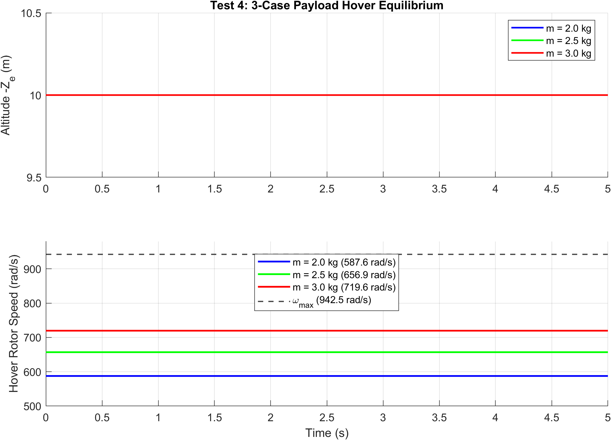
*Figure 13 — Test 4 payload equilibrium (`test4_payload_equilibrium.png`).*

**Test 5 — Closed-loop PD step.** A 10° roll and pitch step is tracked without divergence. Tilt-compensated total thrust rises to ≈20.238 N, corresponding to an equivalent rotor speed of 596.7 rad/s (peak individual rotor speed 604.885 rad/s). The 3D Euler kinematics produce a small yaw transient peaking at **0.5587°**, immediately corrected by the PD yaw loop.

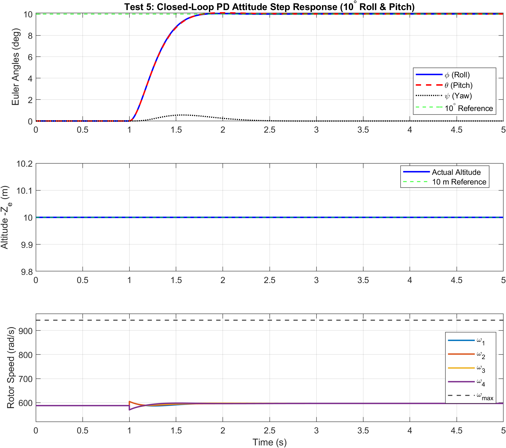
*Figure 14 — Test 5 closed-loop PD response (`test5_pd_control_response.png`).*

---

## 5. System-Level Payload, Sensitivity & Mission Energy Analysis (Step 6)

### 5.1 Electrical power model fit

Single-rotor electrical power and pack current were fitted over the eight sweep points (0.6228–12.6086 N). A degree-3 polynomial was selected as the strictly monotonic fit with the lowest RMSE: **R² = 0.999935, RMSE = 0.8381 W** (pack-current fit R² = 0.999865, RMSE = 0.3765 A). Fitted hover power at `T₁ = 4.905 N` is **64.026 W/rotor = 256.10 W total**, bracketed by the 5000 RPM (45.01 W) and 6000 RPM (79.62 W) sweep points.


*Figure 15 — Electrical power versus thrust fit validation (`power_thrust_fit.png`).*

### 5.2 Payload and thrust-margin study

| Mass (kg) | Payload added (kg) | Hover thrust total (N) | Per rotor (N) | Hover RPM | Max thrust (N) | TWR | Margin (N) | Shaft P (W) | Elec P (W) | Pack I (A) | Usable Wh | Endurance (min) |
|---|---|---|---|---|---|---|---|---|---|---|---|---|
| 2.0 | 0.0 | 19.62 | 4.905 | 5610.9828 | 50.4787 | 2.5728 | 30.8587 | 239.5797 | 256.1023 | 17.6669 | 59.2 | 13.8695 |
| 2.5 | 0.5 | 24.525 | 6.1313 | 6273.2695 | 50.4787 | 2.0583 | 25.9537 | 334.8229 | 363.0697 | 25.2327 | 59.2 | 9.7832 |
| 3.0 | 1.0 | 29.43 | 7.3575 | 6872.0224 | 50.4787 | 1.7152 | 21.0487 | 440.1361 | 488.7651 | 34.4701 | 59.2 | 7.2673 |

Maximum deviation of hover RPM and TWR from `test4_payload_summary.csv` is **0.0005 %**, well within the 0.5 % acceptance threshold.

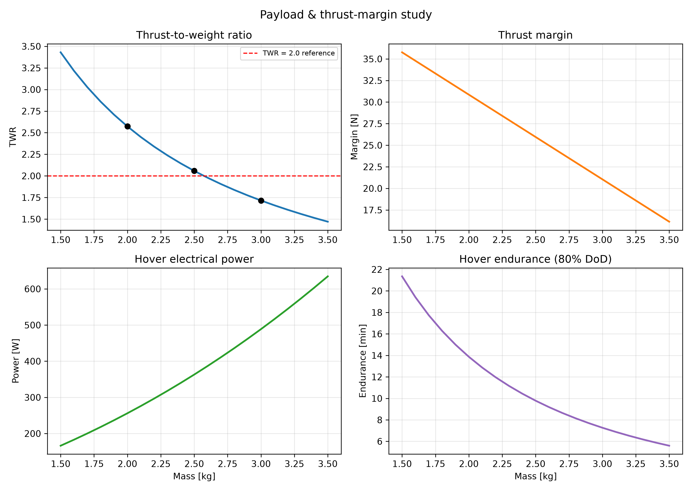
*Figure 16 — TWR, thrust margin, hover power and endurance versus mass (`payload_thrust_margin.png`).*

### 5.3 Parameter sensitivity (±10 %)

Because `kf ∝ C_T D⁴` and `km ∝ C_Q D⁵`, a larger rotor lowers disk loading: hover speed scales approximately `D⁻¹` and hover power falls, while the `ω_max` ceiling yields higher static thrust and TWR.

| Case | D (m) | C_T | Hover RPM | Max thrust (N) | TWR | Hover power (W) | ΔRPM (%) | Δthrust (%) | ΔTWR (%) | Δpower (%) |
|---|---|---|---|---|---|---|---|---|---|---|
| Baseline | 0.2540 | 0.110 | 5610.98 | 50.4787 | 2.5728 | 256.1023 | 0.00 | 0.00 | 0.00 | 0.00 |
| D −10 % | 0.2286 | 0.110 | 6927.14 | 33.1191 | 1.6880 | 284.5581 | +23.46 | −34.39 | −34.39 | +11.11 |
| D +10 % | 0.2794 | 0.110 | 4637.18 | 73.9059 | 3.7669 | 232.8203 | −17.36 | +46.41 | +46.41 | −9.09 |
| C_T −10 % | 0.2540 | 0.099 | 5914.50 | 45.4308 | 2.3155 | 299.9506 | +5.41 | −10.00 | −10.00 | +17.12 |
| C_T +10 % | 0.2540 | 0.121 | 5349.86 | 55.5266 | 2.8301 | 221.9854 | −4.65 | +10.00 | +10.00 | −13.32 |

C_T scales `kf` only (not `km`), so thrust/RPM/TWR move directly while electrical power follows through the fitted hover efficiency `eta_hover = 0.9355`.


*Figure 17 — One-at-a-time ±10 % sensitivity of D and C_T (`parameter_sensitivity.png`).*

### 5.4 Four-phase mission energy

The blueprint profile was used exactly (not the optional fallback): take-off 5 s at 1.15 mg, climb 30 s at 1.08 mg, hover 600 s at 1.00 mg, descent/landing 35 s at 0.92 mg, total 670 s.

| Phase | Duration (s) | Multiplier | Total thrust (N) | Per rotor (N) | RPM | Elec power (W) | Pack I (A) | Phase Wh | Phase kJ | Cumulative Wh | Cumulative Ah | End SoC (%) |
|---|---|---|---|---|---|---|---|---|---|---|---|---|
| Take-off | 5.0 | 1.15 | 22.5630 | 5.64075 | 6017.1087 | 318.1209 | 22.0213 | 0.4418 | 1.5906 | 0.4418 | 0.0306 | 99.3883 |
| Climb | 30.0 | 1.08 | 21.1896 | 5.2974 | 5831.1044 | 288.3874 | 19.9230 | 2.4032 | 8.6516 | 2.8451 | 0.1966 | 96.0678 |
| Hover | 600.0 | 1.00 | 19.6200 | 4.9050 | 5610.9828 | 256.1023 | 17.6669 | 42.6837 | 153.6614 | 45.5288 | 3.1411 | 37.1783 |
| Descent/Landing | 35.0 | 0.92 | 18.0504 | 4.5126 | 5381.8656 | 225.5785 | 15.5535 | 2.1931 | 7.8952 | 47.7219 | 3.2923 | 34.1540 |
| **TOTAL** | **670.0** | — | — | — | — | — | — | **47.7219** | **171.7988** | 47.7219 | 3.2923 | **34.1540** |

End SoC 34.15 % clears the 20 % LiPo reserve. Coulomb counting (Ah drawn) is used throughout so `mission_energy.csv` and `battery_sensitivity.csv` agree exactly; it sits slightly below the simple nominal-voltage energy ratio because terminal voltage sags under load (Section 3, Figure 8), so more ampere-hours are drawn per watt-hour than `E/V_nom` suggests.

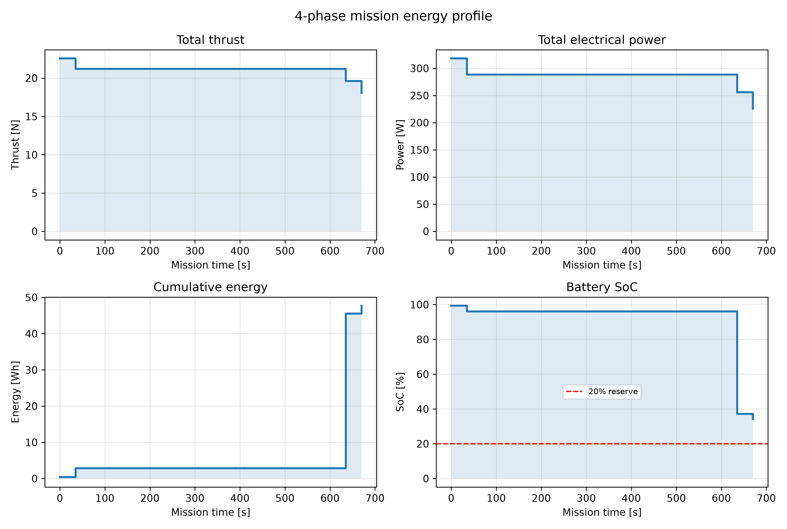
*Figure 18 — Four-phase thrust, power, cumulative energy and SoC (`mission_energy_profile.png`).*

### 5.5 Battery capacity sensitivity

| Case | Capacity (Ah) | Mass (kg) | Nominal Wh | Usable Wh (80 %) | Hover power (W) | Hover endurance (min) | Mission Wh | Post SoC (%) | Reserve satisfied |
|---|---|---|---|---|---|---|---|---|---|
| Fixed-mass | 4.0 | 2.0 | 59.2 | 47.36 | 256.1023 | 11.0956 | 47.7219 | 17.6925 | False |
| Mass-adjusted | 4.0 | 1.9 | 59.2 | 47.36 | 236.8217 | 11.9989 | 44.1281 | 23.9246 | True |
| Fixed-mass | 5.0 | 2.0 | 74.0 | 59.20 | 256.1023 | 13.8695 | 47.7219 | 34.1540 | True |
| Mass-adjusted | 5.0 | 2.0 | 74.0 | 59.20 | 256.1023 | 13.8695 | 47.7219 | 34.1540 | True |
| Fixed-mass | 6.0 | 2.0 | 88.8 | 71.04 | 256.1023 | 16.6434 | 47.7219 | 45.1283 | True |
| Mass-adjusted | 6.0 | 2.1 | 88.8 | 71.04 | 276.0709 | 15.4395 | 51.4441 | 40.8000 | True |

Fixed-mass endurance rises 11.10 → 13.87 → 16.64 min; with the realistic +0.10 kg/Ah mass penalty the gains diminish to 12.00 → 13.87 → 15.44 min. At 4 Ah the fixed-mass case falls below the 20 % reserve while the lighter mass-adjusted configuration stays above it.


*Figure 19 — Hover endurance and post-mission SoC versus capacity (`battery_capacity_sensitivity.png`).*

---

## 6. PX4 SITL vs. 6-DoF Cross-Simulation Comparison (Step 7)

### 6.1 Scope and matched maneuver

This section reports a **simulation-to-simulation cross-comparison**, not experimental flight validation. A +10° roll step was flown in PX4 SITL (Gazebo `gz_x500`, manifest `attitude_step_run.json`), held 8.0 s, and extracted from `09_52_14.ulg` into a 1402-sample, 100 Hz, 14.01 s aligned window. The step onset in aligned time is t = 0.980 s and the hold ends at 9.040 s (8.06 s hold).

Both systems use FRD body / NED local frames, so **no NED-to-NWU sign flip** was applied. The absolute PX4 NED heading (~96°) was normalised relative to the window-start value so the plant could start at ψ = 0.

### 6.2 Quantitative metrics

Full table from `px4_comparison/comparison_results/px4_vs_6dof_metrics.csv`:

| Axis | PX4 RMSE vs SP (°) | Sim RMSE vs SP (°) | Cross-sim RMSE (°) | PX4 overshoot (%) | Sim overshoot (%) | PX4 rise (s) | Sim rise (s) | PX4 settle 2 % (s) | Sim settle 2 % (s) | PX4 settle 5 % (s) | Sim settle 5 % (s) | PX4 SS err (°) | Sim SS err (°) | PX4 peak rate (rad/s) | Sim peak rate (rad/s) |
|---|---|---|---|---|---|---|---|---|---|---|---|---|---|---|---|
| Roll (excited) | 1.967958 | 1.539408 | **0.629211** | 10.572997 | 0.626659 | 0.33 | 0.43 | 5.33 | 0.69 | 1.74 | 0.61 | 0.073812 | 0.216868 | 0.535598 | 0.426267 |
| Pitch (cross) | 0.321547 | 0.0000000724 | 0.321547 | — | — | — | — | — | — | — | — | 0.593815 | 0.0000000710 | 0.017581 | 0.0000000171 |
| Yaw (cross) | 1.848533 | 0.00000146 | 1.848533 | — | — | — | — | — | — | — | — | −3.044866 | 0.000000166 | 0.089936 | 0.000000021 |

Roll cross-simulator RMSE of 0.629° indicates consistent closed-loop behaviour under the matched command. PX4 reaches the step faster (0.33 s) but overshoots more (10.57 % vs 0.63 %) and takes longer to settle to 2 % (5.33 s vs 0.69 s).

### 6.3 Physical interpretation of differences

- **Controller architecture:** PX4 SITL uses cascaded attitude-P / angular-rate-PID with rate limiting and feedforward; the 6-DoF plant uses a single-loop PD attitude law. The inner rate loop explains PX4's faster rise and larger overshoot/longer settling as it unwinds.
- **Plant and actuation fidelity:** Gazebo `gz_x500` includes motor lag, ESC dynamics, aerodynamic drag and estimator noise; the Simulink plant uses static quadratic rotors, instantaneous rotor speed and `D_drag = 0`. This yields higher PX4 tracking RMSE and small nonzero cross-axis steady-state offsets.
- **Ground-proximity caveat:** the logged PX4 altitude during the step window is only ≈0.04 m (`dist_bottom ≈ 0`), whereas the 6-DoF replay holds 10 m. Ground effect/contact and possible saturation distort the PX4 response; the altitude-hold comparison is therefore **not** like-for-like. This is transparently flagged in the extraction script and plots.
- All figures carry the subtitle "SIMULATION-TO-SIMULATION comparison (PX4 SITL vs Simulink) — not flight-test validation".

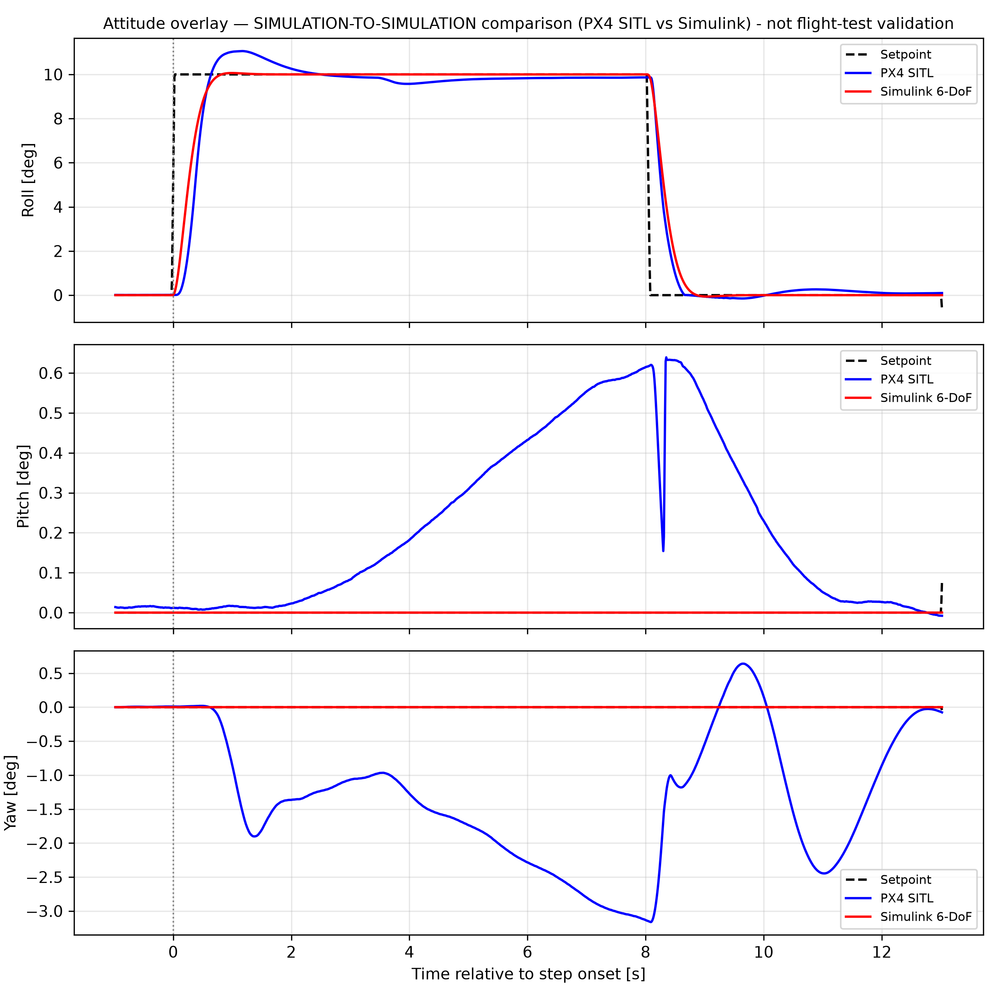
*Figure 20 — Setpoint versus PX4 SITL versus Simulink 6-DoF attitude overlay (`attitude_overlay_comparison.png`).*

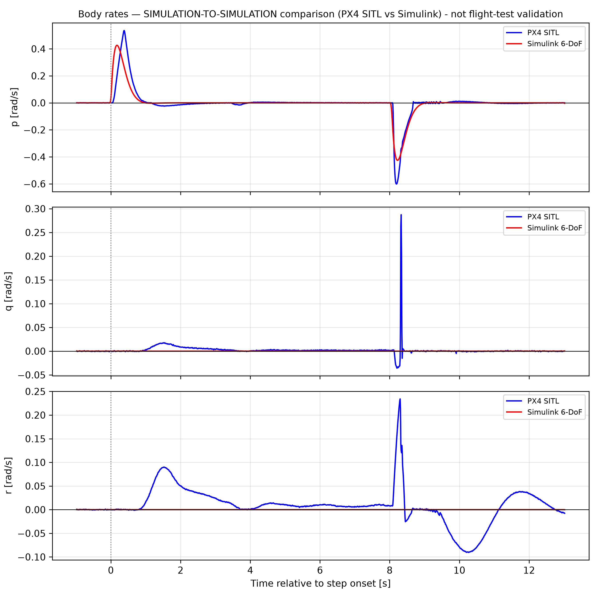
*Figure 21 — Body rates p, q, r comparison (`angular_rate_comparison.png`).*

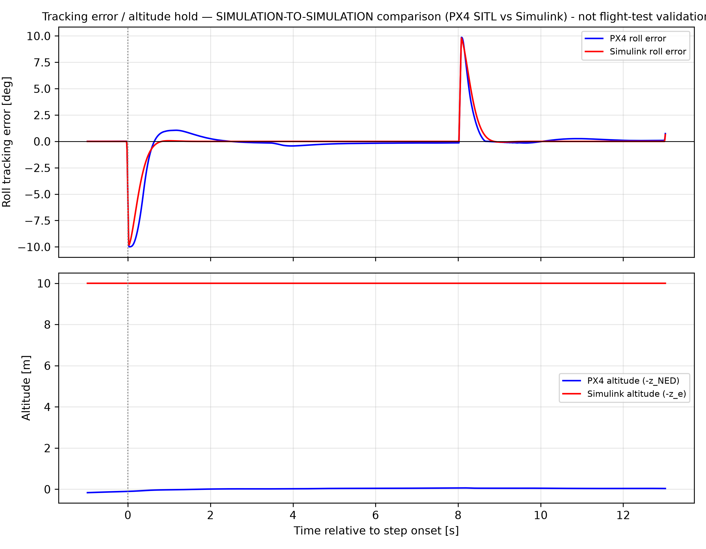
*Figure 22 — Roll tracking error and altitude hold comparison (`tracking_error_comparison.png`).*

---

## 7. Limitations, Conclusions & Future Work

### 7.1 Conclusions

The seven-step workflow produced a fully traceable evidence chain: both legacy models were audited, the propulsion model was corrected and independently verified to <0.01 % error, a clean 6-DoF plant passed all five mandatory tests, system-level studies quantified payload/mission/battery trade-offs, and a matched PX4 SITL replay produced a 0.629° roll cross-simulator RMSE. Every reported number is reproduced from generated artefacts in the repository.

### 7.2 Limitations

- **Static rotor assumption:** `T_i = kf ω_i²`, `Q_i = km ω_i²` with no rotor-speed lag in the 6-DoF loop.
- **Zero aerodynamic drag:** `D_drag = 0` by design (documented omission), so translational damping is absent.
- **Ideal sensors/actuation:** no sensor noise, filtering or ESC dynamics in the Simulink plant.
- **Ground-proximity log:** the PX4 step was recorded at ≈0.04 m altitude, limiting the validity of the altitude-hold comparison.
- **Simulation-only scope:** both sides of the Step 7 comparison are simulated; no flight-test claim is made.

### 7.3 Future work

1. Add a first-order motor/ESC lag to the rotor-speed path and repeat Step 5 and Step 7.
2. Introduce identified aerodynamic drag coefficients and repeat the mission-energy study.
3. Re-fly the PX4 SITL scenario with confirmed in-air altitude (>2 m) and repeat the extraction/comparison; ultimately repeat with hardware-in-the-loop or controlled flight data if physical validation is required.

### 7.4 Evidence repository checklist

- [x] Model audit and `HoverLock` retirement
- [x] Physical configuration and parameter register
- [x] 8-point propulsion sweep and analytical verification
- [x] Clean 6-DoF model and five verification tests
- [x] Payload/thrust-margin study
- [x] Mission energy and battery sensitivity studies
- [x] PX4 SITL cross-simulation comparison
- [ ] Traceable final report (this document) — **complete upon compilation of `final_report.pdf` / `final_report.docx`**
